# Grafo de Arquitectura y Red del Sistema — Plan Progresivo Scout ASV (Protocolo Graphy + Full-System Graphify v3.0.0)

> **Suite de Artefactos Activa (`npm run graphify`)**:
> 1. **[`SYSTEM_GRAPH.md`](file:///home/lya/proyectos/plan-progresivo/SYSTEM_GRAPH.md)** — Mapa Mermaid, Contratos de Interfaces, Matriz de Roles y Bitácora de Sincronización (Protocolo Graphy).
> 2. **[`CLAUDE.md`](file:///home/lya/proyectos/plan-progresivo/CLAUDE.md)** & **[`.claude/agents/`](file:///home/lya/proyectos/plan-progresivo/.claude/agents)** — Guía operativa y 5 subagentes (`codebase-scout`, `code-reviewer`, `db-guardian`, `qa-tester`, `ui-designer`) para Claude Code.
> 3. **[`graphify-out/GRAPH_REPORT.md`](file:///home/lya/proyectos/plan-progresivo/graphify-out/GRAPH_REPORT.md)** — Manual arquitectónico exhaustivo de las **8 Comunidades**, **25 Pantallas**, **17 Componentes**, **12 Servicios**, **9 Catálogos** y **11 Tablas SQL**.
> 4. **[`graphify-out/graph.json`](file:///home/lya/proyectos/plan-progresivo/graphify-out/graph.json)** & **[`graphify-out/qa_matrix.json`](file:///home/lya/proyectos/plan-progresivo/graphify-out/qa_matrix.json)** — Grafo legible por máquina (`88 nodos`, `55 aristas`, `4 hiperaristas`) y matriz de 10 suites QA (`QA-01`..`QA-10`).
> 5. **[`graphify-out/graph.html`](file:///home/lya/proyectos/plan-progresivo/graphify-out/graph.html)** — Explorador visual interactivo del grafo de conocimiento.
> 6. **[`src/lib/graphifyBridge.ts`](file:///home/lya/proyectos/plan-progresivo/src/lib/graphifyBridge.ts)** — Puente en tiempo de ejecución `window.__SCOUT_GRAPHIFY__` para navegación instantánea y diagnósticos.

---

## 1. Mapa de Conexiones (Red Viva — 8 Comunidades)

```mermaid
flowchart TD
    %% ==========================================
    %% COMUNIDAD 1: ENTRADA, CONTEXTOS Y ROUTER MULTI-ROL
    %% ==========================================
    subgraph C1 ["1. Core Entry, Contextos y Router Multi-Rol"]
        APP["App.tsx\n(PWA SW /sw.js, Reconnect Sync,\ninitGraphifyBridge)"]
        NAV["AppNavigator.tsx\n(Stack Router por Rol + Deep Linking)"]
        DRAWER["DrawerNavigator.tsx\n(15 Rutas Scout + Tema + PWA)"]
        AUTH_CTX["AuthContext.tsx\n(Cache <10ms + Supabase Auth)"]
        THEME_CTX["ThemeContext.tsx\n(Dark Mode + Primary Color)"]
        NOTIF_CTX["NotificationContext.tsx\n(Badge + Toast + Push)"]
    end

    %% ==========================================
    %% COMUNIDAD 2: SERVICIOS BACKEND, OFFLINE Y DOCX
    %% ==========================================
    subgraph C2 ["2. Servicios Backend, Cola Offline, Realtime y DOCX"]
        DATA_SVC["dataService.ts\n(39 métodos: Cola Offline FIFO,\nEtapas, Certificados, Planes, Bitácoras)"]
        PROG_SVC["programaService.ts\n(CRUD Programas + Cache Local)"]
        STOR_SVC["storageService.ts\n(Compresión Canvas <=800px + Bucket)"]
        AUTOSAVE_SVC["autoSaveService.ts\n(Debounce 300ms Borradores)"]
        PRESENCE_SVC["presenceService.ts\n(Realtime scout_presence_global)"]
        NOTIF_SVC["notificationService.ts\n(In-App + Browser + Push)"]
        WEBPUSH_SVC["webPushService.ts\n(VAPID Push Subscriptions)"]
        DOCX_PROG["docxProgramaGenerator.ts\n(Exportador OpenXML Programa)"]
        DOCX_EXP["docxExporter.ts\n(Exportador Ficha Médica / Currículum)"]
        PDF_ORION["fichaOrion84PdfGenerator.ts\n(Rellena plantilla PDF Orión 84,\npdf-lib bajo demanda)"]
        BRIDGE["graphifyBridge.ts\n(window.__SCOUT_GRAPHIFY__)"]
    end

    %% ==========================================
    %% COMUNIDAD 3: PANTALLAS DE PROGRESIÓN SCOUT
    %% ==========================================
    subgraph C3 ["3. Autenticación y Progresión Scout"]
        SCR_AUTH["LoginScreen / RegisterScreen"]
        SCR_SCOUT_DASH["ScoutDashboardScreen\n(Resumen, Carnet, Onboarding)"]
        SCR_PLAN["PlanProgresivoScreen\n(Precursor, Expedicionario,\nDescubridor, Fundador)"]
        SCR_STAGE["StageDetailScreen\n(Checklist, Envío a Revisión)"]
        SCR_CATALOG["CatalogSelectorScreen\n(Catálogo Oficial ASV)"]
        SCR_ESPEC["EspecialidadesScreen\n(Bronce, Plata, Oro)"]
        SCR_PROF["ProfileScreen / ScoutFullProfileScreen"]
    end

    %% ==========================================
    %% COMUNIDAD 4: DASHBOARDS DIRIGENTES Y ESTRUCTURA
    %% ==========================================
    subgraph C4 ["4. Dirigentes y Jerarquía Territorial"]
        SCR_SCOUTER["ScouterDashboardScreen &\nScouterReviewScreen (Unidad)"]
        SCR_JEFE["JefeGrupoScreen\n(Supervisión Grupo y Membresías)"]
        SCR_COMIS["ComisionadoDashboardScreen\n(Distrital / Regional / Nacional / Admin)"]
    end

    %% ==========================================
    %% COMUNIDAD 5: PROGRAMAS, PLAN TRIMESTRAL Y AGENDA
    %% ==========================================
    subgraph C5 ["5. Programas Scout, Plan Trimestral y Drive"]
        SCR_PROG["ProgramaScoutScreen &\nProgramaScoutEditorScreen"]
        SCR_QUART["QuarterlyPlanScreen\n(Trimestres I-IV Individual / Unidad)"]
        SCR_CAL["CalendarScreen & ActivityCenterScreen"]
        SCR_DRIVE["TemporalDriveScreen\n(Álbumes de Evidencia)"]
    end

    %% ==========================================
    %% COMUNIDAD 6: DOCUMENTOS OFICIALES Y MANUALES OFFLINE
    %% ==========================================
    subgraph C6 ["6. Ficha Médica, Currículum, Certificados y Manuales"]
        SCR_FICHA["FichaMedicaScreen\n(Pestañas: Ficha Scout .docx |\nFicha Orión 84 PDF)"]
        SCR_CURR["CurriculumScoutScreen"]
        SCR_CERT["CertificateUploadScreen"]
        SCR_OFFLINE["NudosManualScreen, CancioneroScreen\n& DocumentosScreen (100% Offline)"]
    end

    %% ==========================================
    %% COMUNIDAD 7 & 8: COMPONENTES, CATÁLOGOS Y SUPABASE
    %% ==========================================
    subgraph C7 ["7. Modales y Componentes Reutilizables (17)"]
        ORION_FORM["FichaMedicaOrion84Form\n(autocompletado + guardado en\nmedical_data.orion84)"]
        SCOUT_ICON["ScoutUserIcon\n(silueta con pañoleta)"]
        MODALS["CarnetScoutModal, NochesAireLibreModal,\nVidaGrupoModal, ProgramaPdfPreviewModal,\nNotificationCenterModal, ThemeCustomizerModal,\nPWAInstallModal, HelpFloatingFAB, ManualVisualDiagram"]
    end

    subgraph C8 ["8. Catálogos Estáticos (8) y Persistencia Supabase (11 Tablas)"]
        CATALOGS["progressionTemplate, activitiesCatalog,\nachievementIndicatorsData (6 Áreas),\nsdgData (17 ODS), specialtiesData"]
        LOCAL_DB[("AsyncStorage / localStorage\n(@scout_outbox_v1 · cola offline,\n@scout_rc_* · copias de lectura,\n@scout_cached_profile, @scout_programas_list)")]
        SUPA_DB[("Supabase PostgreSQL (11 Tablas RLS):\nprofiles, stage_progress, requirement_progress,\ncertificates, scout_programas, quarterly_plans,\ncalendar_events, scout_notifications, notifications,\npush_subscriptions, bug_reports")]
        SUPA_STOR[("Supabase Storage Bucket:\nscout-files")]
        PUSH_API["Vercel Serverless:\napi/send-push.js + public/sw.js"]
    end

    %% Flujos Principales
    APP --> AUTH_CTX & THEME_CTX & NOTIF_CTX & NAV & BRIDGE
    NAV --> DRAWER & SCR_AUTH & SCR_SCOUTER & SCR_JEFE & SCR_COMIS
    DRAWER --> SCR_SCOUT_DASH & SCR_PLAN & SCR_PROG & SCR_QUART & SCR_FICHA & SCR_CURR & SCR_CERT & SCR_DRIVE & SCR_OFFLINE
    SCR_PLAN --> SCR_STAGE --> SCR_CATALOG & MODALS
    SCR_STAGE & SCR_SCOUTER & SCR_JEFE & SCR_COMIS & SCR_QUART & SCR_CAL & SCR_CERT --> DATA_SVC
    SCR_PROG --> PROG_SVC & DOCX_PROG & AUTOSAVE_SVC & CATALOGS
    SCR_FICHA & SCR_CURR --> DOCX_EXP & AUTOSAVE_SVC
    SCR_FICHA --> ORION_FORM --> PDF_ORION
    SCR_SCOUT_DASH --> SCOUT_ICON
    DATA_SVC & PROG_SVC & AUTH_CTX --> LOCAL_DB
    DATA_SVC & PROG_SVC & NOTIF_SVC --> SUPA_DB
    STOR_SVC & SCR_DRIVE & SCR_CERT --> SUPA_STOR
    WEBPUSH_SVC --> PUSH_API & SUPA_DB
```

---

## 2. Catálogo de Interfaces y Contratos Verificados

| Módulo / Archivo | Funciones / Métodos Clave | Entradas / Salidas y Comportamiento | Tablas Supabase / Storage Keys |
| :--- | :--- | :--- | :--- |
| [`App.tsx`](file:///home/lya/proyectos/plan-progresivo/App.tsx) | `registerSW()`, `outbox.startAutoSync()`, `initGraphifyBridge()` | Registra `/sw.js`, arranca la sincronización automática de la cola offline (al volver la red, al volver a la app y cada 30 s), monta `<OfflineStatusBanner/>` y `window.__SCOUT_GRAPHIFY__`. | `@scout_outbox_v1` |
| [`src/lib/offline/`](file:///home/lya/proyectos/plan-progresivo/src/lib/offline) (`outbox.ts`, `net.ts`, `readCache.ts`, `offlineDocs.ts`) | `outbox.run/enqueue/flush/register/subscribe`, `must()`, `isNetworkError()`, `cachedQuery()`, `saveDocOffline()`, `appPdfUrl()` | **Motor offline**: cola genérica de operaciones con reintento ordenado (red → espera; otros errores → 5 intentos y queda "con error"); lecturas red-primero con copia local; guías PDF en Cache Storage (`scoutplan-docs-v1`) y proxy `/asv-pdf/*` → scouts.org.ve. supabase-js NO lanza sin red: se revisa `error` con `must()`. | `@scout_outbox_v1` (migra `@scout_offline_sync_queue`), `@scout_rc_*`, caché `scoutplan-docs-v1` |
| [`supabaseClient.ts`](file:///home/lya/proyectos/plan-progresivo/src/lib/supabaseClient.ts) | `offlineAwareFetch` | Sin red falla al instante con `AbortError` (postgrest-js no reintenta) y corta lecturas a los 20 s. | — |
| [`AppNavigator.tsx`](file:///home/lya/proyectos/plan-progresivo/src/navigation/AppNavigator.tsx) | `AppNavigator`, `registerGraphifyControllers()` | Enrutamiento condicional por `user.role` (`scout`, `scouter`, `jefe_grupo`, `comisionado_distrital`, `comisionado_regional`, `nacional`, `admin`) y puente de navegación programática. | `profiles` |
| [`AuthContext.tsx`](file:///home/lya/proyectos/plan-progresivo/src/context/AuthContext.tsx) | `user`, `signOut()`, `refreshProfile()`, `updateUserProfile(updates, { localOnly })` | Restauración instantánea desde caché local; **sin red conserva el perfil guardado** (no lo rehace con valores por defecto); `updateUserProfile` escribe vía cola offline; precarga fotos propias para uso offline. | `profiles`, `@scout_cached_profile`, `@scout_cached_session` |
| [`dataService.ts`](file:///home/lya/proyectos/plan-progresivo/src/lib/dataService.ts) | `syncPendingRequirements()` (→ `outbox.flush()`), `toggleRequirement()`, `submitStageForReview()`, `approveStage()`, `rejectStage()`, `uploadCertificate()`, `syncCertificateToCurriculum()`, `saveQuarterlyPlan()`, `addNightEntry()`, `addVidaGrupoEntry()`, `proposeMembershipDate()`, `approveMembershipDate()` | **39 métodos asíncronos**: motor offline-first para requisitos, aprobación de etapas por Scouter, sincronización automática de certificados hacia el Currículum Scout, planes trimestrales individuales/grupales y bitácoras de campismo/vida de grupo. | `profiles`, `stage_progress`, `requirement_progress`, `certificates`, `quarterly_plans`, `calendar_events`, `@scout_outbox_v1` (migra `@scout_offline_sync_queue`) |
| [`programaService.ts`](file:///home/lya/proyectos/plan-progresivo/src/lib/programaService.ts) | `getProgramas()`, `getProgramaById()`, `savePrograma()`, `deletePrograma()`, `duplicatePrograma()` | CRUD completo de Programas Scout (de unidad o sinodales) con respaldo offline y sincronización bidireccional en Supabase. | `scout_programas`, `@scout_programas_list` |
| [`storageService.ts`](file:///home/lya/proyectos/plan-progresivo/src/lib/storageService.ts) | `uploadImage(bucketName, folderPath, fileName, fileOrBase64)` | Redimensiona y comprime imágenes `>800px` en cliente mediante HTML5 Canvas (`JPEG 0.85`) y retorna URL pública CDN. | Bucket `scout-files` |
| [`docxProgramaGenerator.ts`](file:///home/lya/proyectos/plan-progresivo/src/lib/docxProgramaGenerator.ts) & [`docxExporter.ts`](file:///home/lya/proyectos/plan-progresivo/src/utils/docxExporter.ts) | `docxProgramaGenerator.generateAndDownload(programa)`, `exportDocxInBrowser(...)` | Inyección OpenXML (`JSZip`) sobre plantillas oficiales `.docx` en `public/` preservando membretes, logos de unidad, firmas y tablas. | `public/programa_assets/Programa_Template.docx`, `public/FICHA_MEDICA_Template.docx`, `public/Curriculum_Scout_Template.docx` |
| [`fichaOrion84PdfGenerator.ts`](file:///home/lya/proyectos/plan-progresivo/src/lib/fichaOrion84PdfGenerator.ts) & [`fichaMedicaOrion84Layout.ts`](file:///home/lya/proyectos/plan-progresivo/src/data/fichaMedicaOrion84Layout.ts) | `fillFichaOrion84Pdf(templateBytes, values)`, `downloadFichaOrion84Pdf(values, fileName)`, `ORION84_SECTIONS`, `ORION84_HEADER_LABELS` | Rellena la plantilla Canva (sin campos rellenables) dibujando texto en coordenadas medidas por celda; reduce/parte el texto y marca con "…" si no cabe. El MediaBox de la plantilla empieza en y = 7,92 (se mide desde su borde real). `pdf-lib` se carga bajo demanda desde `pdf-lib/dist` (la versión ESM rompe Metro por `tslib`). | `public/FICHA_MEDICA_ORION84_Template.pdf`, `profiles.medical_data.orion84` |
| [`notificationService.ts`](file:///home/lya/proyectos/plan-progresivo/src/services/notificationService.ts) & [`webPushService.ts`](file:///home/lya/proyectos/plan-progresivo/src/services/webPushService.ts) | `sendNotification()`, `getUserNotifications()`, `registerDevicePushSubscription()`, `dispatchBackgroundPushToUser()` | Despacho multicanal (Toast en vivo, bandeja `scout_notifications`, Notification API del navegador y Web Push VAPID vía `api/send-push.js`). | `scout_notifications`, `notifications`, `push_subscriptions` |
| [`presenceService.ts`](file:///home/lya/proyectos/plan-progresivo/src/services/presenceService.ts) | `init(user)`, `subscribe(cb)`, `isUserOnline(userId, lastSeenIso)`, `destroy()` | Canal Supabase Realtime `scout_presence_global` + latido en `profiles.updated_at`. | `profiles` (Realtime) |
| [`graphifyBridge.ts`](file:///home/lya/proyectos/plan-progresivo/src/lib/graphifyBridge.ts) | `initGraphifyBridge()`, `window.__SCOUT_GRAPHIFY__` | Expone `navigate(route, params)`, `getState()`, `runDiagnostics()`, `uiTestHelpers` y acceso directo a servicios para pruebas E2E en Claude Code. | Todas las rutas y servicios |

---

## 3. Bitácora de Sincronización y Modelos

| Fecha | Acción (Alta / Poda / Refactor) | Módulos Afectados | Modelo Utilizado |
| :--- | :--- | :--- | :--- |
| 2026-10-19 | **Alta Inicial de Grafo (Protocolo Graphy)**: Mapeo base de navegación multi-rol, contextos y servicios. | `SYSTEM_GRAPH.md` | Gemini 3.8 Flash |
| 2026-10-19 | **Mejora Integral Full-System Graphify (v3.0.0)**: Creación del puente en tiempo de ejecución [`src/lib/graphifyBridge.ts`](file:///home/lya/proyectos/plan-progresivo/src/lib/graphifyBridge.ts) (`window.__SCOUT_GRAPHIFY__`) integrado en [`App.tsx`](file:///home/lya/proyectos/plan-progresivo/App.tsx) y [`AppNavigator.tsx`](file:///home/lya/proyectos/plan-progresivo/src/navigation/AppNavigator.tsx); creación del analizador [`scripts/graphify.js`](file:///home/lya/proyectos/plan-progresivo/scripts/graphify.js) (`npm run graphify`) que genera [`graphify-out/GRAPH_REPORT.md`](file:///home/lya/proyectos/plan-progresivo/graphify-out/GRAPH_REPORT.md), [`graphify-out/graph.json`](file:///home/lya/proyectos/plan-progresivo/graphify-out/graph.json), [`graphify-out/qa_matrix.json`](file:///home/lya/proyectos/plan-progresivo/graphify-out/qa_matrix.json) y [`graphify-out/graph.html`](file:///home/lya/proyectos/plan-progresivo/graphify-out/graph.html) (8 comunidades, 84 nodos, 49 aristas, 4 hiperaristas, 10 suites QA, 12/12 verificaciones); actualización de [`CLAUDE.md`](file:///home/lya/proyectos/plan-progresivo/CLAUDE.md) y creación de los 5 subagentes en [`.claude/agents/`](file:///home/lya/proyectos/plan-progresivo/.claude/agents). | `SYSTEM_GRAPH.md`, `CLAUDE.md`, `.claude/agents/*`, `scripts/graphify.js`, `src/lib/graphifyBridge.ts`, `App.tsx`, `src/navigation/AppNavigator.tsx`, `package.json`, `graphify-out/*` | Gemini 4 Argon |
| 2026-10-25 | **Alta (Seguridad RLS)**: nuevo [`supabase_rls_correcciones.sql`](file:///home/lya/proyectos/plan-progresivo/supabase_rls_correcciones.sql) (ejecutar después de `supabase_rls_seguridad.sql` y `supabase_rls_resto.sql`). Funciones nuevas `mismo_grupo(text)`, `es_dirigente(uuid)` y RPC públicas `directorio_grupo()` / `perfil_publico(text)`; triggers `proteger_alta_perfil`, `proteger_aprobacion_etapa`, `asignar_grupo_y_autor`, `asignar_remitente`; reglas por grupo en `calendar_events` y `scout_programas`; reglas por dueño en `certificates`, `scout_notifications` y `bug_reports`. `dataService.getUnitRoversDirectory()` y `ScoutFullProfileScreen` usan las RPC; `api/send-push.js` autoriza por grupo/ámbito y solo acepta rutas internas; `public/sw.js` no abre URLs externas; `initGraphifyBridge()` solo en `__DEV__`. | `supabase_rls_correcciones.sql`, `src/lib/dataService.ts`, `src/screens/ScoutFullProfileScreen.tsx`, `src/lib/graphifyBridge.ts`, `api/send-push.js`, `public/sw.js` | Claude Opus 5.5 |
| 2026-10-25 | **Alta (Ficha Médica doble + icono + QA)**: `FichaMedicaScreen` con pestañas *Ficha Médica Scout* / *Ficha Médica Orión 84*; nuevos [`FichaMedicaOrion84Form.tsx`](file:///home/lya/proyectos/plan-progresivo/src/components/FichaMedicaOrion84Form.tsx), [`fichaOrion84PdfGenerator.ts`](file:///home/lya/proyectos/plan-progresivo/src/lib/fichaOrion84PdfGenerator.ts), [`fichaMedicaOrion84Layout.ts`](file:///home/lya/proyectos/plan-progresivo/src/data/fichaMedicaOrion84Layout.ts), [`ScoutUserIcon.tsx`](file:///home/lya/proyectos/plan-progresivo/src/components/ScoutUserIcon.tsx) y plantilla `public/FICHA_MEDICA_ORION84_Template.pdf`; dependencia `pdf-lib@1.17.1`. Correcciones de QA: canal Realtime único en `QuarterlyPlanScreen` (pantalla en blanco), 17 condiciones `{texto && …}` → `{!!texto && …}`. `scripts/graphify.js`: nodos nuevos, arista DOCX corregida y conteos validados contra el disco. | `src/screens/FichaMedicaScreen.tsx`, `src/screens/ScoutDashboardScreen.tsx`, `src/screens/QuarterlyPlanScreen.tsx`, `src/navigation/DrawerNavigator.tsx`, `scripts/graphify.js`, `graphify-out/*` | Claude Opus 5.5 |
| 2026-11-03 | **Alta (Modo offline completo + QA E2E de 3 roles)**: nuevo motor [`src/lib/offline/`](file:///home/lya/proyectos/plan-progresivo/src/lib/offline) (`outbox`, `net`, `readCache`, `offlineDocs`), [`OfflineStatusBanner.tsx`](file:///home/lya/proyectos/plan-progresivo/src/components/OfflineStatusBanner.tsx), [`utils/safeUrl.ts`](file:///home/lya/proyectos/plan-progresivo/src/utils/safeUrl.ts), [`utils/dateLocal.ts`](file:///home/lya/proyectos/plan-progresivo/src/utils/dateLocal.ts), [`scripts/build-sw.js`](file:///home/lya/proyectos/plan-progresivo/scripts/build-sw.js) (lista de pre-descarga del service worker); `dataService` reescrito sobre la cola (nuevos `getAllStageStatuses()`, `getRequirementRows()`, `getProfileRow()`, `updateProfileFields()`, `mergeProfileJson()`, `setProfilePhoto()`; ids UUID en `certificates` — antes fallaban todos los inserts de noches/vida de grupo/CIP/vínculos); `public/sw.js` v2 (no intercepta Supabase, precache por build, caché de guías persistente); `vercel.json` proxy `/asv-pdf/*`; requisito `rov_esp_oro_2`; arreglos en revisión del Scouter, exportaciones (escapado HTML/XSS, Programa .docx con imágenes y tblGrid correctos), fotos con respaldo, fechas locales. | `src/lib/*`, `src/screens/*` (14), `src/components/*` (5), `src/context/AuthContext.tsx`, `src/utils/*`, `src/data/progressionTemplate.ts`, `public/sw.js`, `public/nudos/*`, `public/programa_assets/*`, `scripts/build-sw.js`, `package.json`, `vercel.json` | Claude Opus 5.5 |
| 2026-11-07 | **Sincronización (documentación)**: referencias a la cola antigua `@scout_offline_sync_queue` cambiadas a `@scout_outbox_v1` en el diagrama, la tabla de contratos y la hiperarista de `scripts/graphify.js`; conteos de `CLAUDE.md` puestos al día (93 nodos, 61 aristas, 18 componentes, 16 servicios). Sin cambios de código. | `SYSTEM_GRAPH.md`, `CLAUDE.md`, `scripts/graphify.js`, `graphify-out/*` | Claude Opus 5.5 |
| 2026-11-07 | **Alta (Reportes, membresía y verificación pública)**: Excel real `.xlsx` y PDF directo (`src/utils/reportTable.ts`, `xlsxWriter.ts`, `pdfTableWriter.ts`) para Censo, Padrón, Membresías y Plan Trimestral; avance de insignias exportable (`src/lib/insigniasReport.ts`, `InsigniasExportBar.tsx`); Ficha Médica Scout en PDF (`src/lib/fichaScoutPdfGenerator.ts`); etapas aprobadas en solo lectura con línea de tiempo (`dataService.getStageDates`, `dateLocal.humanDuration`); comprobante de pago + historial de membresía por año (`MembershipRecordsModal.tsx`, filas `certificates` `membresia_pago`/`membresia_hist`; `approveMembershipDate`/`rejectMembershipDate` reciben `expiresAt, byName`); verificación pública del carnet (`api/verificar.js`, `public/verificar.html`, rewrite en `vercel.json`, excluida en `public/sw.js`; QR → `/verificar/<id>`); recordatorio diario de membresía a 30 y 7 días (`api/membership-reminders.js`, cron en `vercel.json`); ramas y edades (`src/data/unitTemplates.ts`: aviso de plantilla en Plan Progresivo, edad y filtro «Edad fuera de rama» en el censo). `ageFrom` pasa a `dateLocal`. | `src/utils/*`, `src/lib/*`, `src/components/*`, `src/screens/{JefeGrupo,ScouterDashboard,ComisionadoDashboard,QuarterlyPlan,FichaMedica,StageDetail,PlanProgresivo,Profile}Screen.tsx`, `api/*`, `public/{sw.js,verificar.html}`, `vercel.json` | Claude Opus 5.5 |
| 2026-11-07 | **Refactor (Nada sin sesión)**: bucket `scout-files` pasa a privado (`supabase_storage_privado.sql`): nueva [`src/lib/fileUrl.ts`](file:///home/lya/proyectos/plan-progresivo/src/lib/fileUrl.ts) (enlaces firmados de 1 h, caché, `clearFileCache` al cerrar sesión) y [`src/components/SecureImage.tsx`](file:///home/lya/proyectos/plan-progresivo/src/components/SecureImage.tsx) en 10 pantallas/componentes; descargas para PDF/Word firmadas; `public/sw.js` guarda archivos por ruta sin token; subidas sin `upsert`. Verificación del carnet ahora exige sesión: [`src/screens/VerificarCarnetScreen.tsx`](file:///home/lya/proyectos/plan-progresivo/src/screens/VerificarCarnetScreen.tsx) (ruta `verificar/:id`, retorno tras iniciar sesión vía `@pending_verify_id`), `api/verificar.js` responde 401 sin sesión; se elimina `public/verificar.html` y sus rewrites. | `src/lib/fileUrl.ts`, `src/components/SecureImage.tsx`, `src/screens/VerificarCarnetScreen.tsx`, `src/navigation/AppNavigator.tsx`, `src/screens/LoginScreen.tsx`, `src/context/AuthContext.tsx`, `api/verificar.js`, `public/sw.js`, `vercel.json` | Claude Opus 5.5 |
| 2026-11-07 | **Alta (Aprobación de cuentas + carnet vencido)**: columna `profiles.account_status` (`supabase_aprobacion_cuentas.sql`: cuentas nuevas `pending`; `mi_grupo`/`mismo_grupo`/`puede_gestionar`/`directorio_grupo` exigen cuenta aprobada; cambiar de grupo vuelve a `pending`; nadie se aprueba a sí mismo). App: [`CuentaEnRevisionScreen.tsx`](file:///home/lya/proyectos/plan-progresivo/src/screens/CuentaEnRevisionScreen.tsx) (puerta en `AppNavigator`), [`PendingAccountsCard.tsx`](file:///home/lya/proyectos/plan-progresivo/src/components/PendingAccountsCard.tsx) en Jefatura y Scouter, `dataService.setAccountStatus`; cuentas sin aprobar fuera de censo/estadísticas/territorial. Carnet, Perfil y lista del Scouter muestran «Anualidad vencida». | `supabase_aprobacion_cuentas.sql`, `src/types/progression.ts`, `src/context/AuthContext.tsx`, `src/navigation/AppNavigator.tsx`, `src/screens/{JefeGrupo,ScouterDashboard,ComisionadoDashboard}Screen.tsx`, `src/components/CarnetScoutModal.tsx` | Claude Opus 5.5 |
| 2026-11-07 | **Alta (pulido offline + actividades personales)**: nuevos [`PendingChangesModal.tsx`](file:///home/lya/proyectos/plan-progresivo/src/components/PendingChangesModal.tsx) (lista de cambios pendientes al tocar el aviso de conexión: reintentar / descartar), [`ActividadesPersonalesModal.tsx`](file:///home/lya/proyectos/plan-progresivo/src/components/ActividadesPersonalesModal.tsx) (registro de las actividades de creación propia; filas `certificates` con categoría `personal_<etapa>_<req>`; `dataService.getPersonalActivities()/addPersonalActivity()/deletePersonalActivity()`; visibles en ScouterReview) y [`ScoutQRCode.tsx`](file:///home/lya/proyectos/plan-progresivo/src/components/ScoutQRCode.tsx) (QR del carnet sin internet, dependencia `qrcode-generator`). Aviso de membresía por vencer/vencida/pendiente/devuelta en el Inicio del Rover; `dateLocal.daysUntil()/formatDateEs()`. `supabaseClient`: cortacircuito de 15 s para lecturas tras un fallo de red (Wi-Fi sin internet ya no deja el Inicio cargando). `build-sw.js`: URLs con `@` sin codificar (íconos de navegación sin internet). Borrado `public/documentos/En señas.pdf` (copia idéntica de `En_senas.pdf`). | `src/components/*` (3 nuevos + `OfflineStatusBanner`, `CarnetScoutModal`), `src/screens/ScoutDashboardScreen.tsx`, `StageDetailScreen.tsx`, `ScouterReviewScreen.tsx`, `src/lib/dataService.ts`, `src/lib/supabaseClient.ts`, `src/utils/dateLocal.ts`, `scripts/build-sw.js`, `scripts/graphify.js`, `package.json` | Claude Opus 5.5 |
| 2026-11-08 | **Alta (Aviso de cuentas por aprobar)**: `supabase_aviso_cuentas_pendientes.sql` agrega el disparador `trg_avisar_cuenta_pendiente` en `profiles` (función `avisar_cuenta_pendiente()`, SECURITY DEFINER): cuando una cuenta queda `pending` (registro o cambio de grupo) inserta en `scout_notifications` un aviso para la Jefatura del grupo y el Scouter de la misma rama. La regla `scout_files_ver` deja de permitir archivos con `owner IS NULL`. Flujo de aprobación verificado E2E en producción con la cuenta QA (pendiente → Jefatura aprueba → entra). |
| 2026-11-08 | **Alta (Administración de grupos y roles)**: nueva [`src/screens/AdministracionScreen.tsx`](file:///home/lya/proyectos/plan-progresivo/src/screens/AdministracionScreen.tsx) (ruta `Administracion` → `/administracion`; botón «🛡️ Roles y miembros» en JefeGrupo y escudo en el panel de Comisionados) y [`src/data/territory.ts`](file:///home/lya/proyectos/plan-progresivo/src/data/territory.ts) (REGIONS, distritos/grupos fijos, `districtsFor`/`groupsFor`, `ROLE_LABELS`, `assignableRoles`, `canMoveMembers`), usada también por RegisterScreen y ComisionadoDashboard. `dataService`: `getScoutGroups`, `createScoutGroup`, `setScoutGroupActive`, `getAdminPeople`, `updateMemberAdmin` (en línea, no por la cola). SQL `supabase_administracion.sql`: tabla `scout_groups` (RLS: ver = cuenta aprobada; crear/editar = `puede_admin_territorio(region, district)`), `proteger_perfil` reescrita (Scouter no cambia roles; Jefatura scout/scouter/jefe en su grupo; mover de grupo solo Comisionados en su territorio o admin), `avisar_cuenta_pendiente` con respaldo a Comisionado/Regional/admin si el grupo no tiene Jefatura, y bloque opcional `grupos_registro()` (anon: solo nombres de grupos activos para el formulario de registro). |
| 2026-11-08 | **Corrección (Administración sobre el catálogo existente)**: `scout_groups` ya existía (`supabase_national_hierarchy_schema.sql`, columnas `region_id`/`district_id`, FK a `scout_regions`/`scout_districts`); `supabase_administracion.sql` ahora la completa (`active`, `created_by`, id por defecto, índice único en `name`, nombres alineados con `profiles.group_name`) y agrega la regla `distritos_crear`. `dataService.getScoutGroups` normaliza a `{region, district}` y devuelve `districts`; `createScoutGroup` crea el distrito nuevo antes del grupo; `territory.registerDistricts` da nombre a los distritos de la base de datos. SQL probado en PGlite (bloques repetibles + 15 pruebas de permisos). |
| 2026-11-08 | **Alta (Cuentas: recuperar contraseña, borrar cuenta, historial, avisos; pulido)**: recuperación de contraseña reparada ([`authRecovery.ts`](file:///home/lya/proyectos/plan-progresivo/src/lib/authRecovery.ts) lee `#type=recovery` porque `detectSessionInUrl` es false; `AuthContext.recoveryMode` → [`NuevaContrasenaScreen.tsx`](file:///home/lya/proyectos/plan-progresivo/src/screens/NuevaContrasenaScreen.tsx); `resetPasswordForEmail` con `redirectTo`). Borrar mi cuenta: [`DeleteAccountModal.tsx`](file:///home/lya/proyectos/plan-progresivo/src/components/DeleteAccountModal.tsx) → [`api/delete-account.js`](file:///home/lya/proyectos/plan-progresivo/api/delete-account.js) (`archivos_de_usuario`, `borrar_datos_de_cuenta`, `auth.admin.deleteUser`). Historial: tabla `audit_log` + disparadores (`supabase_historial_borrado.sql`), pestaña Historial en Administracion (`dataService.getAuditLog`). Avisos: [`api/pending-push.js`](file:///home/lya/proyectos/plan-progresivo/api/pending-push.js) tras el registro; `send-push` exige cuenta aprobada y un joven solo avisa en masa a scouter/jefe_grupo; se quitó el aviso «Nuevo Miembro Registrado» que mandaba el propio registrado. Pulido: [`PullToRefreshScrollView.tsx`](file:///home/lya/proyectos/plan-progresivo/src/components/PullToRefreshScrollView.tsx) en 5 pantallas; nombres de región/distrito desde `scout_regions`/`scout_districts` (`territory.registerRegions`); `dataService.getRequirement` reutiliza todas las filas del scout (antes 1 consulta por requisito, perfil ~10 s). |
| 2026-11-08 | **Poda (catálogo oficial vigente)**: se quitaron de [`activitiesCatalog.ts`](file:///home/lya/proyectos/plan-progresivo/src/data/activitiesCatalog.ts) las 19 filas de «Acción Comunitaria» y «Concurso de Vida al Aire Libre / de Acción Comunitaria» (ya no existen; Bronce/Plata/Oro se reemplazan por los cursos Horqueta/Remo/Canoa, que ya están en las etapas). Ninguna se usaba en el código. [`progressionTemplate.ts`](file:///home/lya/proyectos/plan-progresivo/src/data/progressionTemplate.ts): Descubridor agrega `des_cip_nacional` (2 actividades), según el cuadro oficial. |
| 2026-11-08 | **Alta (CIP oficiales)**: tabla `cip_oficiales` (`supabase_cip_oficiales.sql`; RLS: CIP de grupo los crea Jefatura/Scouter y los ve el grupo; los de Comisionados por territorio; nacionales solo admin/Nacional) y disparador `proteger_cip_acreditado` (el joven no puede crear/editar/borrar sus `cip_sel_*`). [`CipManagerModal.tsx`](file:///home/lya/proyectos/plan-progresivo/src/components/CipManagerModal.tsx) («Gestionar CIP» en ScouterDashboard y «🚩 CIP» en JefeGrupo): catálogo, marcar asistencia (cuenta al requisito `<x>_cip_<nivel>` de la etapa en curso, `cipLogic.cipTargetFor`) y revisar solicitudes. [`CipStageModal.tsx`](file:///home/lya/proyectos/plan-progresivo/src/components/CipStageModal.tsx) reemplaza la autoselección del joven en StageDetail: ve lo acreditado y pide CIP anteriores a la app (`cip_sol_*`) bajo la Ley Scout («El Scout cifra su honor en ser digno de confianza»). `dataService`: `getCipCatalog`, `createCipOficial`, `setCipOficialActive`, `getCipRowsForScouts`, `markCipAttendance`, `unmarkCipAttendance`, `requestOldCip`, `deleteOldCipRequest`, `reviewOldCip`; `_rescueLocalOnlyRows` ya no sube `cip_sel_*`. |
| 2026-11-08 | **Seguridad, en vivo, velocidad y pulido**: `supabase_seguridad_vivo.sql` (calendario sin la excepción «[CIP…]»; avisos de grupo/rama/rol visibles por RLS `notificaciones_grupo_ver`; `notificaciones_crear` solo a uno mismo/propio grupo/gestionados; `proteger_perfil` bloquea que uno cambie su `membership_expires_at`; `notifications` y `scout_notifications` en la publicación `supabase_realtime`; presencia en canal privado `presencia:<grupo>` con reglas en `realtime.messages`; diagnóstico). App: `notificationService` deja el canal broadcast público (cualquiera, incluso sin sesión, podía escucharlo) y usa `postgres_changes` filtrado por RLS (incluye `scout_notifications`); `presenceService` usa el canal privado del grupo. Velocidad: Inicio 53→12 consultas (recargaba 6-7 veces; `updateLastSeen` cada 2 min), etapa 40→18 (`_allCertRows` una consulta por scout, invalidada con `outbox.subscribe`). Pulido: avisos de Inicio (2 + «Ver todos», rojo solo si es negativo), Ficha Médica (género en su fila), modo oscuro (tema de navegación, `theme.accentText`), Perfil con nombres de región/distrito, sin `console.log`, `verificar.js` sin detalle técnico, código CIP viejo eliminado (`createCipEvent`, `getCipEvents`, modal del Scouter). Pruebas: [`tests/sql/run.mjs`](file:///home/lya/proyectos/plan-progresivo/tests/sql/run.mjs) (`npm run test:sql`, 78 comprobaciones); QA-11..QA-14. |
| 2026-11-08 | **Pulido (avisos unificados, modo oscuro, Telegram)**: `notificationService.sendNotification` ya no copia cada aviso directo en `scout_notifications` (salía dos veces en la campanita; esa tabla queda para los avisos que crea la base de datos); `getUserNotifications` oculta los duplicados viejos y corrige el público: un aviso dirigido a un rol solo lo ve ese rol y lo que uno envía a otros no le aparece a uno. Inicio usa la lista de `NotificationContext` (se actualiza sola en vivo) en vez de `dataService.getUnreadNotifications`. `ThemeContext`: en modo oscuro `primaryColor`/`colors.primary` se aclaran 30 % (contraste 2,2→4,8) y `basePrimaryColor` conserva el color elegido para `ThemeCustomizerModal`; textos de requisitos de StageDetail con `theme.accentText`. `api/telegram-notify.js` solo acepta cuentas aprobadas. |
| 2026-11-08 | **Alta (respaldos y reglas abiertas)**: [`api/backup.js`](file:///home/lya/proyectos/plan-progresivo/api/backup.js) + cron semanal en `vercel.json` (`0 7 * * 0`): respaldo .json.gz de 15 tablas en el bucket privado `respaldos` (últimas 8; el plan gratuito de Supabase no tiene copias automáticas). `supabase_cerrar_reglas_abiertas.sql`: pasa a `authenticated` toda regla de `public` para anon/public (el diagnóstico halló una en una tabla creada desde el panel) y quita permisos directos de anon; probado en `tests/sql/run.mjs`. |
| 2026-11-09 | **Corrección (reportes del usuario)**: Plan Trimestral — ya no descarta la respuesta de la nube a los 3,5 s (mostraba un plan vacío con el nombre de quien lo abría como autor), aviso «Cargando…», nunca pone autor por abrir, abre en el trimestre actual (antes Q1); `supabase_plan_unidad_visible.sql`: los jóvenes LEEN el plan de su unidad (hecho por un dirigente; los personales siguen privados), antes no lo veían ni en el Calendario. Calendario: meses tolerantes, CIP del catálogo, modos Día/Trimestre/Próximas/CIP, excluye álbumes del Drive. Drive de fotos: guardaba solo en el teléfono (faltaba `date`, filtraba por `end_date` inexistente, errores silenciados) → ahora id UUID, fecha, `group_name`, avisos de error. [`PdfViewer.tsx`](file:///home/lya/proyectos/plan-progresivo/src/components/PdfViewer.tsx) (pdf.js en `public/pdfjs`, precacheado en `build-sw.js`) para ver guías dentro de la app en Android. Modo oscuro: requisitos marcados de StageDetail sin «destello» morado; pestañas y pasos de Manuales con colores del tema. |
| 2026-11-09 | **Corrección (fotos)**: [`DualProfileAvatar.tsx`](file:///home/lya/proyectos/plan-progresivo/src/components/DualProfileAvatar.tsx) — cada pestaña muestra solo su foto y siempre abre en «Foto Scout»; en listas (Resumen, Rovers, paneles) se ve la foto scout o el ícono scout, nunca la personal (antes la personal reemplazaba a la scout y aparecía en la pestaña «Foto Scout» del perfil completo). [`CarnetScoutModal.tsx`](file:///home/lya/proyectos/plan-progresivo/src/components/CarnetScoutModal.tsx): el carnet usa solo la foto scout (aviso «Súbela en tu Perfil»). |
| 2026-11-09 | **Sincronización (Graphify completo)**: nodos que faltaban desde antes — [`apiClient.ts`](file:///home/lya/proyectos/plan-progresivo/src/lib/apiClient.ts) y [`api/telegram-notify.js`](file:///home/lya/proyectos/plan-progresivo/api/telegram-notify.js) — con sus conexiones; rol de `DualProfileAvatar` actualizado a la regla de fotos; conteos de CLAUDE.md al día. Verificado: todas las pantallas, componentes, servicios de `src/lib` y funciones de `api/` tienen nodo, sin conexiones rotas. |
| 2026-11-09 | **Corrección (offline al abrir sin internet)**: [`supabaseClient.ts`](file:///home/lya/proyectos/plan-progresivo/src/lib/supabaseClient.ts) — abrir la app SIN internet con la sesión vencida (dura 1 h) la dejaba cargando para siempre: supabase-js reintentaba renovar la sesión ~30 s y cada consulta esperaba. Ahora `_callRefreshToken` responde al instante con `AuthRetryableFetchError` sin red (la sesión no se borra) y espera máx. 5 s con Wi-Fi sin salida; las consultas que saldrían con la clave pública tras saltar la renovación no se envían (`guardedFetch`); al volver `online` se renueva. **Alta**: [`warmup.ts`](file:///home/lya/proyectos/plan-progresivo/src/lib/offline/warmup.ts) (`warmOfflineData`, desde `AuthContext` 4 s después de cargar el perfil y al volver internet, máx. cada 10 min): guarda en el teléfono los datos de todas las pantallas aunque nunca se hayan abierto. **Alta**: [`calendarData.ts`](file:///home/lya/proyectos/plan-progresivo/src/lib/calendarData.ts) (`loadCalendarEvents`, `monthNumber`; sale de CalendarScreen; sin internet los CIP guardados ya no pisan la copia del calendario). `dataService`: `_allCertRows` guarda `certs_<id>`; `_getCategoryRows` y `getAllLinkedCertificates` usan esa copia sin red. |
| 2026-11-09 | **Pulido (modo oscuro)**: auditoría de contraste WCAG en 25 pantallas y 4 roles; 115 textos `color: colors.primary/primaryColor` → `theme.accentText` (en modo claro no cambia); encabezados con el morado original sobre negro, «25 % completado», «Desconectado», días de otros meses, fichas claras de Nudos/Drive, colores de Jefatura/Comisionada, botones verdes de guardar (#059669), etiquetas «ACREDITACIÓN», botón deshabilitado de etapa (#64748b). |
| 2026-11-09 | **Alta (recortar fotos)**: [`PhotoCropModal.tsx`](file:///home/lya/proyectos/plan-progresivo/src/components/PhotoCropModal.tsx) (mover, pellizcar/barra/botones 1×–4×, girar 90°, guía circular, JPEG 800×800) y [`photoCrop.ts`](file:///home/lya/proyectos/plan-progresivo/src/utils/photoCrop.ts) (cálculos puros). `DualProfileAvatar` pasa cada foto elegida por el recorte y agrega «Recortar / Ajustar» para la foto guardada; `CurriculumScoutScreen` igual. |
| 2026-11-09 | **Alta (pruebas de pantallas)**: [`run.mjs`](file:///home/lya/proyectos/plan-progresivo/tests/e2e/run.mjs) (`npm run test:e2e`; Supabase simulado en [`mockSupabase.mjs`](file:///home/lya/proyectos/plan-progresivo/tests/e2e/mockSupabase.mjs), contraste en [`contrast.mjs`](file:///home/lya/proyectos/plan-progresivo/tests/e2e/contrast.mjs), servidor [`serve.mjs`](file:///home/lya/proyectos/plan-progresivo/tests/e2e/serve.mjs)): 25 pantallas × 4 roles × claro/oscuro, editor de programas, y abrir sin internet con la sesión vencida. [`photoCrop.test.mjs`](file:///home/lya/proyectos/plan-progresivo/tests/unit/photoCrop.test.mjs) (`npm run test:unit`). `npm test` = unitarias + SQL + pantallas. |
| 2026-11-09 | **Refactor (archivos largos, sin cambiar comportamiento)**: estilos a `src/screens/<pantalla>/styles.ts` (programaEditor, quarterlyPlan, jefeGrupo, nudosManual); [`DatePickerModal.tsx`](file:///home/lya/proyectos/plan-progresivo/src/screens/programaEditor/DatePickerModal.tsx) y [`IndicatorPickerModal.tsx`](file:///home/lya/proyectos/plan-progresivo/src/screens/programaEditor/IndicatorPickerModal.tsx) salen del Editor de Programas (2837→1914 líneas); contenido de manuales a [`manualsData.ts`](file:///home/lya/proyectos/plan-progresivo/src/data/manualsData.ts) (NudosManualScreen 1908→872). |
| 2026-11-10 | **Alta (pruebas en cada publicación)**: `vercel.json` compila con `npm run build:vercel` (pruebas unitarias + base de datos antes de `build:web`: si fallan no se publica); `engines.node` 24.x. [`pruebas.yml`](file:///home/lya/proyectos/plan-progresivo/.github/workflows/pruebas.yml): unitarias + SQL + pantallas en cada push/PR, con Supabase de mentira; si fallan, correo y capturas en Artifacts. `tests/e2e/run.mjs` compila SIEMPRE con `https://e2eprueba.supabase.co` (nunca depende del `.env`). |
| 2026-11-10 | **Alta (restaurar respaldo)**: [`restore-backup.mjs`](file:///home/lya/proyectos/plan-progresivo/scripts/restore-backup.mjs) + [`backupRestore.mjs`](file:///home/lya/proyectos/plan-progresivo/scripts/lib/backupRestore.mjs) (`--list`, prueba sin escribir, `--apply` upsert por id con la clave de servicio, `--tables`). `tests/sql/run.mjs`: respaldo como `api/backup.js` → borrar/dañar → restaurar → comparar (los disparadores no bloquean). Limitación: el respaldo no incluye las cuentas de Supabase Auth. |
| 2026-11-10 | **Alta (errores de la app)**: [`errorReporter.ts`](file:///home/lya/proyectos/plan-progresivo/src/lib/errorReporter.ts) (errores sin capturar → `bug_reports` «[Error automático]», sin ruido de red/extensiones, 1/día por error y 5/sesión, cola sin internet), [`AppErrorBoundary.tsx`](file:///home/lya/proyectos/plan-progresivo/src/components/AppErrorBoundary.tsx) (pantalla caída → aviso «Algo salió mal» + Telegram), [`AppErrorsModal.tsx`](file:///home/lya/proyectos/plan-progresivo/src/components/AppErrorsModal.tsx) («🐞 Errores de la app» en JefeGrupo). [`supabase_errores_app.sql`](file:///home/lya/proyectos/plan-progresivo/supabase_errores_app.sql): política `reportes_jefatura_ver` (la Jefatura lee los reportes de su grupo, solo lectura). |
| 2026-11-10 | **Pulido visual**: letra mínima (379 tamaños: ≤9 px → 11, 10–11 → 12; excepto vista previa PDF y carnet). Inicio: avisos largos en 3 líneas con «Ver más». Botones con emoji y dibujo repetidos → solo dibujo («Errores de la app» con ícono `Bug`). Regla de botones [`buttons.ts`](file:///home/lya/proyectos/plan-progresivo/src/theme/buttons.ts) (principal morado / secundario con borde e ícono de color / peligro rojo) en Plan Trimestral, Avance de insignias y herramientas de Comisionado. [`Skeleton.tsx`](file:///home/lya/proyectos/plan-progresivo/src/components/Skeleton.tsx) en 13 pantallas. [`PanelHeader.tsx`](file:///home/lya/proyectos/plan-progresivo/src/components/PanelHeader.tsx) en Scouter, Jefatura y Comisionado. [`layout.ts`](file:///home/lya/proyectos/plan-progresivo/src/theme/layout.ts) (`contentMax` 960 px) en Inicio, Plan Progresivo y paneles. Modo oscuro: morado aclarado 25 % (letra blanca en botones 4,4 → 5,0). [`screenshots.mjs`](file:///home/lya/proyectos/plan-progresivo/tests/e2e/screenshots.mjs) saca capturas de todas las pantallas para revisar el diseño. |
| 2026-11-10 | **Editor de Programas**: [`AutoGrowTextInput.tsx`](file:///home/lya/proyectos/plan-progresivo/src/components/AutoGrowTextInput.tsx) (cajas de texto que crecen con el texto y la ventana: descripción de la dinámica, objetivo general, notas). Cronograma arrastrable: [`DragHandle.tsx`](file:///home/lya/proyectos/plan-progresivo/src/screens/programaEditor/DragHandle.tsx) + [`useScheduleDrag.ts`](file:///home/lya/proyectos/plan-progresivo/src/screens/programaEditor/useScheduleDrag.ts) (arrastrar #n con dedo o ratón, se desplaza solo cerca del borde; un toque abre las flechas). [`programaNotes.ts`](file:///home/lya/proyectos/plan-progresivo/src/lib/programaNotes.ts) `visibleNotes()` / `notesWithMeta()`: las etiquetas internas de `important_notes` (`PLAN_ACT_ID`, `PROGRAMA_STATUS`, `PREVIEW_ROLES`, `AUTHOR_ID`, `AUTHOR_NAME`) ya no se ven en el editor, la vista previa ni el .docx, y cada guardado ya no agrega líneas vacías (causa del hueco en «Notas importantes»). | `src/screens/ProgramaScoutEditorScreen.tsx`, `src/lib/programaService.ts`, `src/components/ProgramaPdfPreviewModal.tsx`, `src/lib/docxProgramaGenerator.ts` | Claude Opus 5.5 |
| 2026-11-13 | **Corrección (revisión de fichas y catálogo)** — caso real Clan Orión 84: etapas aprobadas sin registros y un Rover con etapas bloqueadas aprobadas y luego quitadas. [`ScouterReviewScreen.tsx`](file:///home/lya/proyectos/plan-progresivo/src/screens/ScouterReviewScreen.tsx): calcula el estado de la etapa en la cadena (`getAllStageStatuses`); **etapa bloqueada** = solo consulta, sin botón de aprobar; la ficha abre en **modo consulta** (botón «✏️ Editar requisitos» para marcar/desmarcar; antes cada toque cambiaba el requisito al momento); marcar un requisito sin registro pide confirmación «¿Convalidar sin registro?» (`missingEvidence`); los requisitos marcados sin registro dicen «Convalidado (sin …)» en vez de «0 de 12». [`CatalogSelectorScreen.tsx`](file:///home/lya/proyectos/plan-progresivo/src/screens/CatalogSelectorScreen.tsx): etapa en revisión/aprobada muestra aviso «solo puedes consultar» + botón «Ir a mi etapa actual» (antes las casillas no respondían sin decir por qué). **Alta**: [`supabase_historial_etapas.sql`](file:///home/lya/proyectos/plan-progresivo/supabase_historial_etapas.sql) (disparadores `registrar_cambio_etapa` en `stage_progress` y `registrar_cambio_requisito` en `requirement_progress` → `audit_log` acciones `etapa`/`requisito`; función `nombre_etapa`); íconos en Administración › Historial. Datos de una vez: [`scripts/datos/2026-11-13_limpiar_daniel_rivero.sql`](file:///home/lya/proyectos/plan-progresivo/scripts/datos/2026-11-13_limpiar_daniel_rivero.sql). | `src/screens/ScouterReviewScreen.tsx`, `src/screens/CatalogSelectorScreen.tsx`, `src/screens/AdministracionScreen.tsx`, `supabase_historial_etapas.sql`, `tests/sql/run.mjs`, `tests/e2e/run.mjs` | Claude Opus 5.5 |
| 2026-11-13 | **Alta (animación de inicio)**: [`public/index.html`](file:///home/lya/proyectos/plan-progresivo/public/index.html) muestra al abrir/recargar la app la flor de lis rodando, la cuerda que se dibuja y el nudo (SVG + CSS, sin depender del JavaScript de la app; funciona sin internet). Expone `window.__hideScoutSplash()`, que [`AppNavigator.tsx`](file:///home/lya/proyectos/plan-progresivo/src/navigation/AppNavigator.tsx) llama cuando deja de cargar la sesión (reemplaza el indicador de carga). Mínimo 1,9 s; con `navigator.webdriver` se quita al instante (pruebas); respaldo a los 15 s; respeta «reducir movimiento». | `public/index.html`, `src/navigation/AppNavigator.tsx` | Claude Opus 5.5 |
| 2026-11-13 | **Corrección (animación de inicio)**: a veces el círculo no se dibujaba (salía el nudo y entraba la app). Causas: la animación SVG (SMIL) no arranca hasta que termina de cargar la app, y la salida era por reloj (1,9 s). Ahora la cuerda se dibuja girando dos mitades recortadas (CSS `transform`, la mueve la tarjeta gráfica aunque el teléfono esté ocupado) y la pantalla sale solo al terminar la animación (`animationend` del título) y la app esté lista; respaldo 4 s tras avisar la app. | `public/index.html` | Claude Opus 5.5 |
| 2026-11-13 | **Cambio (animación de inicio, opción A elegida por el usuario)**: arranca idéntica a la pantalla que pone Android al abrir la app instalada (fondo `#612499` liso, círculo ≈ 36 % del ancho al centro; el script calcula `--dx`, `--dy`, `--s0` antes del primer cuadro) y "cobra vida": crece a su lugar mientras la flor da una vuelta, el nudo se aprieta y sube el título. Flor y nudo en capas HTML propias (giro por tarjeta gráfica). Sin franjas en las barras del teléfono (bordes del mismo morado). | `public/index.html` | Claude Opus 5.5 |
| 2026-11-13 | **Corrección (animación de inicio en la app instalada)**: Chrome quita su pantalla del ícono al primer pintado con contenido o al `load` (lo que pase primero) y la desvanece; la animación ya en marcha se veía encimada con el ícono medio transparente. Ahora, en `display-mode: standalone`, la animación espera quieta en su primer cuadro (clase `ss-wait`, `animation-play-state: paused`) hasta `load` + 450 ms (tope 3,5 s) y luego corre; en pestaña normal arranca al instante. | `public/index.html` | Claude Opus 5.5 |
| 2026-11-13 | **Ajuste (animación de inicio)**: el primer cuadro quedaba ~16 px (de pantalla) más arriba que el ícono de Android. Android centra el ícono en la pantalla completa y la página va entre la barra superior (94 px) y la de navegación (60 px): centro al 49,33 % del alto de la página y círculo al 36,39 % del ancho (medido en capturas 1080×2400 del usuario; verificado a 1–2 px con densidades 2,625 y 2,75). | `public/index.html` | Claude Opus 5.5 |
| 2026-11-13 | **Alta (celebración de insignias)**: cuando el Scouter aprueba una etapa, el scout ve una celebración a pantalla completa la próxima vez que abre o vuelve a la app (o al instante si llega el aviso `badge`). [`BadgeCelebrationWatcher.tsx`](file:///home/lya/proyectos/plan-progresivo/src/components/BadgeCelebrationWatcher.tsx) (montado en `App.tsx`; solo rol `scout`; no corre con `navigator.webdriver`) compara `stage_progress` con `@scout_celebrated_stages_<id>` (AsyncStorage) usando [`badgeCelebration.ts`](file:///home/lya/proyectos/plan-progresivo/src/utils/badgeCelebration.ts) `planCelebrations()` / `isMaxBadge()` (la primera vez solo las aprobadas en 7 días; una etapa devuelta y re-aprobada se celebra otra vez). Dibujo en [`celebration.web.ts`](file:///home/lya/proyectos/plan-progresivo/src/lib/celebration.web.ts) `showBadgeCelebration()` (HTML/CSS con transform/opacity; [`celebration.ts`](file:///home/lya/proyectos/plan-progresivo/src/lib/celebration.ts) = no-op nativo): insignia normal con rayos, ondas y confeti; la **máxima de la rama** (última etapa; Clan = Rover Ciudadano) en dorado con fuegos artificiales, lluvia dorada y estrellas. Colores compartidos en [`stageColors.ts`](file:///home/lya/proyectos/plan-progresivo/src/theme/stageColors.ts); `BADGE_IMAGES` exportado de `StageBadgeIcon.tsx`; `uiTestHelpers.celebrate(stageId)` en el puente Graphify (solo desarrollo). Pruebas: `tests/unit/badgeCelebration.test.mjs`. | `App.tsx`, `src/components/BadgeCelebrationWatcher.tsx`, `src/lib/celebration*.ts`, `src/utils/badgeCelebration.ts`, `src/theme/stageColors.ts`, `src/components/StageBadgeIcon.tsx`, `src/screens/PlanProgresivoScreen.tsx`, `src/lib/graphifyBridge.ts` | Claude Opus 5.5 |
| 2026-11-13 | **Alta (pantallas grandes) y corrección (especialidades)**: [`src/theme/layout.ts`](file:///home/lya/proyectos/plan-progresivo/src/theme/layout.ts) añade `WIDE_BREAKPOINT` (1200 px), `CONTENT_WIDE_MAX_WIDTH` (2400) y `contentWide`; [`ScouterDashboardScreen.tsx`](file:///home/lya/proyectos/plan-progresivo/src/screens/ScouterDashboardScreen.tsx) en ≥1200 px usa casi todo el ancho: accesos en una fila, rovers en cuadrícula y dos columnas (Miembros + Membresía / Insignias + En línea + CIP). [`StageDetailScreen.tsx`](file:///home/lya/proyectos/plan-progresivo/src/screens/StageDetailScreen.tsx): **baja** del botón «Marcar Directo» (especialidades/cursos solo se cumplen vinculando un certificado); «certificado ya utilizado» compara id o título+nivel (antes solo título). [`CertificateUploadScreen.tsx`](file:///home/lya/proyectos/plan-progresivo/src/screens/CertificateUploadScreen.tsx): foto obligatoria para especialidades, cursos o al vincular a un requisito. `tests/e2e/screenshots.mjs` acepta `--width=N`. | `src/theme/layout.ts`, `src/screens/ScouterDashboardScreen.tsx`, `src/screens/StageDetailScreen.tsx`, `src/screens/CertificateUploadScreen.tsx`, `tests/e2e/screenshots.mjs` | Claude Opus 5.5 |
| 2026-11-13 | **Alta (ver celebración y video de la insignia)**: en [`PlanProgresivoScreen.tsx`](file:///home/lya/proyectos/plan-progresivo/src/screens/PlanProgresivoScreen.tsx) cada etapa aprobada tiene «Ver celebración» (repite `showBadgeCelebration`) y «Descargar video». [`celebrationVideo.web.ts`](file:///home/lya/proyectos/plan-progresivo/src/lib/celebrationVideo.web.ts) `openCelebrationVideo()` / `createCelebrationVideo()`: dibuja la escena en `<canvas>` 720×1280 cuadro a cuadro (nombre del scout, grupo, insignia, fecha de aprobación, logo de [`scoutLogoPaths.ts`](file:///home/lya/proyectos/plan-progresivo/src/lib/scoutLogoPaths.ts)) y la codifica a MP4 H.264 en el teléfono con **mediabunny 1.64.0** (WebCodecs, carga diferida en su propio archivo); sin WebCodecs graba con MediaRecorder. Nada se sube a ningún servidor. Ventana con avance, vista previa, Descargar y Compartir (Web Share con archivo). La celebración en vivo ahora dice «¡Felicidades, <nombre>!». [`celebrationVideo.ts`](file:///home/lya/proyectos/plan-progresivo/src/lib/celebrationVideo.ts) = no-op nativo. | `src/screens/PlanProgresivoScreen.tsx`, `src/lib/celebrationVideo*.ts`, `src/lib/scoutLogoPaths.ts`, `src/lib/celebration*.ts`, `src/components/BadgeCelebrationWatcher.tsx`, `package.json` | Claude Opus 5.5 |
| 2026-11-13 | **Pantallas grandes en todos los perfiles + arreglos de teléfono**: con `contentWide`/`WIDE_BREAKPOINT` ([`layout.ts`](file:///home/lya/proyectos/plan-progresivo/src/theme/layout.ts)) en ≥1200 px: [`JefeGrupoScreen.tsx`](file:///home/lya/proyectos/plan-progresivo/src/screens/JefeGrupoScreen.tsx) ramas en dos columnas; [`ComisionadoDashboardScreen.tsx`](file:///home/lya/proyectos/plan-progresivo/src/screens/ComisionadoDashboardScreen.tsx) indicadores en una fila (≥768) y grupos en dos columnas; [`ScoutDashboardScreen.tsx`](file:///home/lya/proyectos/plan-progresivo/src/screens/ScoutDashboardScreen.tsx) etapa+rovers | próximas actividades; [`AdministracionScreen.tsx`](file:///home/lya/proyectos/plan-progresivo/src/screens/AdministracionScreen.tsx) personas en 2/3/4 columnas (antes tope 760 px). Teléfono: [`DrawerNavigator.tsx`](file:///home/lya/proyectos/plan-progresivo/src/navigation/DrawerNavigator.tsx) limita el ancho del título (se montaba sobre los botones) y acorta títulos (Programas, Cancionero, Documentos y Guías); [`TemporalDriveScreen.tsx`](file:///home/lya/proyectos/plan-progresivo/src/screens/TemporalDriveScreen.tsx) «Nuevo Álbum» ya no se sale. `tests/e2e/screenshots.mjs` cubre las 29 pantallas de las pruebas y acepta `--only=rol`. | `src/screens/JefeGrupoScreen.tsx`, `src/screens/ComisionadoDashboardScreen.tsx`, `src/screens/ScoutDashboardScreen.tsx`, `src/screens/AdministracionScreen.tsx`, `src/navigation/DrawerNavigator.tsx`, `src/screens/TemporalDriveScreen.tsx`, `tests/e2e/screenshots.mjs` | Claude Opus 5.5 |
| 2026-11-13 | **Corrección (Gestionar CIP) + alta de pruebas de flujos**: [`CipManagerModal.tsx`](file:///home/lya/proyectos/plan-progresivo/src/components/CipManagerModal.tsx) recargaba al recibir una lista de jóvenes nueva en cada dibujado del panel (en el teléfono, al abrirse el teclado) y desmontaba el formulario «Nuevo CIP» a medio escribir; ahora depende de los ids (`idsKey`) y la ruedita solo sale en la primera carga (`loadedOnce`). **Alta**: [`tests/e2e/flujos.mjs`](file:///home/lya/proyectos/plan-progresivo/tests/e2e/flujos.mjs) (`npm run test:flujos`, también en CI y `npm test`): 22 flujos × teléfono/computadora; [`mockSupabase.mjs`](file:///home/lya/proyectos/plan-progresivo/tests/e2e/mockSupabase.mjs) acepta `{ persist: true }` (POST/PATCH/DELETE/upsert en memoria). | `src/components/CipManagerModal.tsx`, `tests/e2e/flujos.mjs`, `tests/e2e/mockSupabase.mjs`, `package.json`, `.github/workflows/pruebas.yml`, `CLAUDE.md` | Claude Opus 5.5 |
| 2026-11-13 | **Alta: aviso de versión nueva + versión visible**: [`UpdateAvailableBanner.tsx`](file:///home/lya/proyectos/plan-progresivo/src/components/UpdateAvailableBanner.tsx) (montado en `App.tsx`) busca versión nueva del service worker al volver a la app y cada 15 min; si una versión nueva toma el control (`controllerchange`) ofrece «Actualizar» (no recarga sola). [`appVersion.ts`](file:///home/lya/proyectos/plan-progresivo/src/lib/appVersion.ts) `appVersionLabel()` con `EXPO_PUBLIC_BUILD_TIME`/`EXPO_PUBLIC_COMMIT` (los pone `build:web`), visible al pie de [`ThemeCustomizerModal.tsx`](file:///home/lya/proyectos/plan-progresivo/src/components/ThemeCustomizerModal.tsx). Motivo: el teléfono seguía con la copia anterior y el arreglo de CIP no le llegaba. | `src/components/UpdateAvailableBanner.tsx`, `src/lib/appVersion.ts`, `App.tsx`, `src/components/ThemeCustomizerModal.tsx`, `package.json` | Claude Opus 5.5 |
