# Grafo de Arquitectura y Red del Sistema — Plan Progresivo Scout ASV (Protocolo Graphy + Full-System Graphify v3.0.0)

> **Suite de Artefactos Activa (`npm run graphify`)**:
> 1. **[`SYSTEM_GRAPH.md`](file:///home/lya/proyectos/plan-progresivo/SYSTEM_GRAPH.md)** — Mapa Mermaid, Contratos de Interfaces, Matriz de Roles y Bitácora de Sincronización (Protocolo Graphy).
> 2. **[`CLAUDE.md`](file:///home/lya/proyectos/plan-progresivo/CLAUDE.md)** & **[`.claude/agents/`](file:///home/lya/proyectos/plan-progresivo/.claude/agents)** — Guía operativa y 5 subagentes (`codebase-scout`, `code-reviewer`, `db-guardian`, `qa-tester`, `ui-designer`) para Claude Code.
> 3. **[`graphify-out/GRAPH_REPORT.md`](file:///home/lya/proyectos/plan-progresivo/graphify-out/GRAPH_REPORT.md)** — Manual arquitectónico exhaustivo de las **8 Comunidades**, **25 Pantallas**, **17 Componentes**, **12 Servicios**, **9 Catálogos** y **11 Tablas SQL**.
> 4. **[`graphify-out/graph.json`](file:///home/lya/proyectos/plan-progresivo/graphify-out/graph.json)** & **[`graphify-out/qa_matrix.json`](file:///home/lya/proyectos/plan-progresivo/graphify-out/qa_matrix.json)** — Grafo legible por máquina (`88 nodos`, `55 aristas`, `4 hiperaristas`) y matriz de 10 suites QA (`QA-01`..`QA-10`).
> 5. **[`graphify-out/graph.html`](file:///home/lya/proyectos/plan-progresivo/graphify-out/graph.html)** — Explorador visual interactivo del grafo de conocimiento.
> 6. **[`src/lib/graphifyBridge.ts`](file:///home/lya/proyectos/plan-progresivo/src/lib/graphifyBridge.ts)** — Puente en tiempo de ejecución `window.__SCOUT_GRAPHIFY__` para navegación instantánea y diagnósticos.

---

## 1. Mapa de Conexiones (Red Viva — 8 Comunidades)

```mermaid
flowchart TD
    %% ==========================================
    %% COMUNIDAD 1: ENTRADA, CONTEXTOS Y ROUTER MULTI-ROL
    %% ==========================================
    subgraph C1 ["1. Core Entry, Contextos y Router Multi-Rol"]
        APP["App.tsx\n(PWA SW /sw.js, Reconnect Sync,\ninitGraphifyBridge)"]
        NAV["AppNavigator.tsx\n(Stack Router por Rol + Deep Linking)"]
        DRAWER["DrawerNavigator.tsx\n(15 Rutas Scout + Tema + PWA)"]
        AUTH_CTX["AuthContext.tsx\n(Cache <10ms + Supabase Auth)"]
        THEME_CTX["ThemeContext.tsx\n(Dark Mode + Primary Color)"]
        NOTIF_CTX["NotificationContext.tsx\n(Badge + Toast + Push)"]
    end

    %% ==========================================
    %% COMUNIDAD 2: SERVICIOS BACKEND, OFFLINE Y DOCX
    %% ==========================================
    subgraph C2 ["2. Servicios Backend, Cola Offline, Realtime y DOCX"]
        DATA_SVC["dataService.ts\n(39 métodos: Cola Offline FIFO,\nEtapas, Certificados, Planes, Bitácoras)"]
        PROG_SVC["programaService.ts\n(CRUD Programas + Cache Local)"]
        STOR_SVC["storageService.ts\n(Compresión Canvas <=800px + Bucket)"]
        AUTOSAVE_SVC["autoSaveService.ts\n(Debounce 300ms Borradores)"]
        PRESENCE_SVC["presenceService.ts\n(Realtime scout_presence_global)"]
        NOTIF_SVC["notificationService.ts\n(In-App + Browser + Push)"]
        WEBPUSH_SVC["webPushService.ts\n(VAPID Push Subscriptions)"]
        DOCX_PROG["docxProgramaGenerator.ts\n(Exportador OpenXML Programa)"]
        DOCX_EXP["docxExporter.ts\n(Exportador Ficha Médica / Currículum)"]
        PDF_ORION["fichaOrion84PdfGenerator.ts\n(Rellena plantilla PDF Orión 84,\npdf-lib bajo demanda)"]
        BRIDGE["graphifyBridge.ts\n(window.__SCOUT_GRAPHIFY__)"]
    end

    %% ==========================================
    %% COMUNIDAD 3: PANTALLAS DE PROGRESIÓN SCOUT
    %% ==========================================
    subgraph C3 ["3. Autenticación y Progresión Scout"]
        SCR_AUTH["LoginScreen / RegisterScreen"]
        SCR_SCOUT_DASH["ScoutDashboardScreen\n(Resumen, Carnet, Onboarding)"]
        SCR_PLAN["PlanProgresivoScreen\n(Precursor, Expedicionario,\nDescubridor, Fundador)"]
        SCR_STAGE["StageDetailScreen\n(Checklist, Envío a Revisión)"]
        SCR_CATALOG["CatalogSelectorScreen\n(Catálogo Oficial ASV)"]
        SCR_ESPEC["EspecialidadesScreen\n(Bronce, Plata, Oro)"]
        SCR_PROF["ProfileScreen / ScoutFullProfileScreen"]
    end

    %% ==========================================
    %% COMUNIDAD 4: DASHBOARDS DIRIGENTES Y ESTRUCTURA
    %% ==========================================
    subgraph C4 ["4. Dirigentes y Jerarquía Territorial"]
        SCR_SCOUTER["ScouterDashboardScreen &\nScouterReviewScreen (Unidad)"]
        SCR_JEFE["JefeGrupoScreen\n(Supervisión Grupo y Membresías)"]
        SCR_COMIS["ComisionadoDashboardScreen\n(Distrital / Regional / Nacional / Admin)"]
    end

    %% ==========================================
    %% COMUNIDAD 5: PROGRAMAS, PLAN TRIMESTRAL Y AGENDA
    %% ==========================================
    subgraph C5 ["5. Programas Scout, Plan Trimestral y Drive"]
        SCR_PROG["ProgramaScoutScreen &\nProgramaScoutEditorScreen"]
        SCR_QUART["QuarterlyPlanScreen\n(Trimestres I-IV Individual / Unidad)"]
        SCR_CAL["CalendarScreen & ActivityCenterScreen"]
        SCR_DRIVE["TemporalDriveScreen\n(Álbumes de Evidencia)"]
    end

    %% ==========================================
    %% COMUNIDAD 6: DOCUMENTOS OFICIALES Y MANUALES OFFLINE
    %% ==========================================
    subgraph C6 ["6. Ficha Médica, Currículum, Certificados y Manuales"]
        SCR_FICHA["FichaMedicaScreen\n(Pestañas: Ficha Scout .docx |\nFicha Orión 84 PDF)"]
        SCR_CURR["CurriculumScoutScreen"]
        SCR_CERT["CertificateUploadScreen"]
        SCR_OFFLINE["NudosManualScreen, CancioneroScreen\n& DocumentosScreen (100% Offline)"]
    end

    %% ==========================================
    %% COMUNIDAD 7 & 8: COMPONENTES, CATÁLOGOS Y SUPABASE
    %% ==========================================
    subgraph C7 ["7. Modales y Componentes Reutilizables (17)"]
        ORION_FORM["FichaMedicaOrion84Form\n(autocompletado + guardado en\nmedical_data.orion84)"]
        SCOUT_ICON["ScoutUserIcon\n(silueta con pañoleta)"]
        MODALS["CarnetScoutModal, NochesAireLibreModal,\nVidaGrupoModal, ProgramaPdfPreviewModal,\nNotificationCenterModal, ThemeCustomizerModal,\nPWAInstallModal, HelpFloatingFAB, ManualVisualDiagram"]
    end

    subgraph C8 ["8. Catálogos Estáticos (8) y Persistencia Supabase (11 Tablas)"]
        CATALOGS["progressionTemplate, activitiesCatalog,\nachievementIndicatorsData (6 Áreas),\nsdgData (17 ODS), specialtiesData"]
        LOCAL_DB[("AsyncStorage / localStorage\n(@scout_outbox_v1 · cola offline,\n@scout_rc_* · copias de lectura,\n@scout_cached_profile, @scout_programas_list)")]
        SUPA_DB[("Supabase PostgreSQL (11 Tablas RLS):\nprofiles, stage_progress, requirement_progress,\ncertificates, scout_programas, quarterly_plans,\ncalendar_events, scout_notifications, notifications,\npush_subscriptions, bug_reports")]
        SUPA_STOR[("Supabase Storage Bucket:\nscout-files")]
        PUSH_API["Vercel Serverless:\napi/send-push.js + public/sw.js"]
    end

    %% Flujos Principales
    APP --> AUTH_CTX & THEME_CTX & NOTIF_CTX & NAV & BRIDGE
    NAV --> DRAWER & SCR_AUTH & SCR_SCOUTER & SCR_JEFE & SCR_COMIS
    DRAWER --> SCR_SCOUT_DASH & SCR_PLAN & SCR_PROG & SCR_QUART & SCR_FICHA & SCR_CURR & SCR_CERT & SCR_DRIVE & SCR_OFFLINE
    SCR_PLAN --> SCR_STAGE --> SCR_CATALOG & MODALS
    SCR_STAGE & SCR_SCOUTER & SCR_JEFE & SCR_COMIS & SCR_QUART & SCR_CAL & SCR_CERT --> DATA_SVC
    SCR_PROG --> PROG_SVC & DOCX_PROG & AUTOSAVE_SVC & CATALOGS
    SCR_FICHA & SCR_CURR --> DOCX_EXP & AUTOSAVE_SVC
    SCR_FICHA --> ORION_FORM --> PDF_ORION
    SCR_SCOUT_DASH --> SCOUT_ICON
    DATA_SVC & PROG_SVC & AUTH_CTX --> LOCAL_DB
    DATA_SVC & PROG_SVC & NOTIF_SVC --> SUPA_DB
    STOR_SVC & SCR_DRIVE & SCR_CERT --> SUPA_STOR
    WEBPUSH_SVC --> PUSH_API & SUPA_DB
```

---

## 2. Catálogo de Interfaces y Contratos Verificados

| Módulo / Archivo | Funciones / Métodos Clave | Entradas / Salidas y Comportamiento | Tablas Supabase / Storage Keys |
| :--- | :--- | :--- | :--- |
| [`App.tsx`](file:///home/lya/proyectos/plan-progresivo/App.tsx) | `registerSW()`, `outbox.startAutoSync()`, `initGraphifyBridge()` | Registra `/sw.js`, arranca la sincronización automática de la cola offline (al volver la red, al volver a la app y cada 30 s), monta `<OfflineStatusBanner/>` y `window.__SCOUT_GRAPHIFY__`. | `@scout_outbox_v1` |
| [`src/lib/offline/`](file:///home/lya/proyectos/plan-progresivo/src/lib/offline) (`outbox.ts`, `net.ts`, `readCache.ts`, `offlineDocs.ts`) | `outbox.run/enqueue/flush/register/subscribe`, `must()`, `isNetworkError()`, `cachedQuery()`, `saveDocOffline()`, `appPdfUrl()` | **Motor offline**: cola genérica de operaciones con reintento ordenado (red → espera; otros errores → 5 intentos y queda "con error"); lecturas red-primero con copia local; guías PDF en Cache Storage (`scoutplan-docs-v1`) y proxy `/asv-pdf/*` → scouts.org.ve. supabase-js NO lanza sin red: se revisa `error` con `must()`. | `@scout_outbox_v1` (migra `@scout_offline_sync_queue`), `@scout_rc_*`, caché `scoutplan-docs-v1` |
| [`supabaseClient.ts`](file:///home/lya/proyectos/plan-progresivo/src/lib/supabaseClient.ts) | `offlineAwareFetch` | Sin red falla al instante con `AbortError` (postgrest-js no reintenta) y corta lecturas a los 20 s. | — |
| [`AppNavigator.tsx`](file:///home/lya/proyectos/plan-progresivo/src/navigation/AppNavigator.tsx) | `AppNavigator`, `registerGraphifyControllers()` | Enrutamiento condicional por `user.role` (`scout`, `scouter`, `jefe_grupo`, `comisionado_distrital`, `comisionado_regional`, `nacional`, `admin`) y puente de navegación programática. | `profiles` |
| [`AuthContext.tsx`](file:///home/lya/proyectos/plan-progresivo/src/context/AuthContext.tsx) | `user`, `signOut()`, `refreshProfile()`, `updateUserProfile(updates, { localOnly })` | Restauración instantánea desde caché local; **sin red conserva el perfil guardado** (no lo rehace con valores por defecto); `updateUserProfile` escribe vía cola offline; precarga fotos propias para uso offline. | `profiles`, `@scout_cached_profile`, `@scout_cached_session` |
| [`dataService.ts`](file:///home/lya/proyectos/plan-progresivo/src/lib/dataService.ts) | `syncPendingRequirements()` (→ `outbox.flush()`), `toggleRequirement()`, `submitStageForReview()`, `approveStage()`, `rejectStage()`, `uploadCertificate()`, `syncCertificateToCurriculum()`, `saveQuarterlyPlan()`, `addNightEntry()`, `addVidaGrupoEntry()`, `proposeMembershipDate()`, `approveMembershipDate()` | **39 métodos asíncronos**: motor offline-first para requisitos, aprobación de etapas por Scouter, sincronización automática de certificados hacia el Currículum Scout, planes trimestrales individuales/grupales y bitácoras de campismo/vida de grupo. | `profiles`, `stage_progress`, `requirement_progress`, `certificates`, `quarterly_plans`, `calendar_events`, `@scout_outbox_v1` (migra `@scout_offline_sync_queue`) |
| [`programaService.ts`](file:///home/lya/proyectos/plan-progresivo/src/lib/programaService.ts) | `getProgramas()`, `getProgramaById()`, `savePrograma()`, `deletePrograma()`, `duplicatePrograma()` | CRUD completo de Programas Scout (de unidad o sinodales) con respaldo offline y sincronización bidireccional en Supabase. | `scout_programas`, `@scout_programas_list` |
| [`storageService.ts`](file:///home/lya/proyectos/plan-progresivo/src/lib/storageService.ts) | `uploadImage(bucketName, folderPath, fileName, fileOrBase64)` | Redimensiona y comprime imágenes `>800px` en cliente mediante HTML5 Canvas (`JPEG 0.85`) y retorna URL pública CDN. | Bucket `scout-files` |
| [`docxProgramaGenerator.ts`](file:///home/lya/proyectos/plan-progresivo/src/lib/docxProgramaGenerator.ts) & [`docxExporter.ts`](file:///home/lya/proyectos/plan-progresivo/src/utils/docxExporter.ts) | `docxProgramaGenerator.generateAndDownload(programa)`, `exportDocxInBrowser(...)` | Inyección OpenXML (`JSZip`) sobre plantillas oficiales `.docx` en `public/` preservando membretes, logos de unidad, firmas y tablas. | `public/programa_assets/Programa_Template.docx`, `public/FICHA_MEDICA_Template.docx`, `public/Curriculum_Scout_Template.docx` |
| [`fichaOrion84PdfGenerator.ts`](file:///home/lya/proyectos/plan-progresivo/src/lib/fichaOrion84PdfGenerator.ts) & [`fichaMedicaOrion84Layout.ts`](file:///home/lya/proyectos/plan-progresivo/src/data/fichaMedicaOrion84Layout.ts) | `fillFichaOrion84Pdf(templateBytes, values)`, `downloadFichaOrion84Pdf(values, fileName)`, `ORION84_SECTIONS`, `ORION84_HEADER_LABELS` | Rellena la plantilla Canva (sin campos rellenables) dibujando texto en coordenadas medidas por celda; reduce/parte el texto y marca con "…" si no cabe. El MediaBox de la plantilla empieza en y = 7,92 (se mide desde su borde real). `pdf-lib` se carga bajo demanda desde `pdf-lib/dist` (la versión ESM rompe Metro por `tslib`). | `public/FICHA_MEDICA_ORION84_Template.pdf`, `profiles.medical_data.orion84` |
| [`notificationService.ts`](file:///home/lya/proyectos/plan-progresivo/src/services/notificationService.ts) & [`webPushService.ts`](file:///home/lya/proyectos/plan-progresivo/src/services/webPushService.ts) | `sendNotification()`, `getUserNotifications()`, `registerDevicePushSubscription()`, `dispatchBackgroundPushToUser()` | Despacho multicanal (Toast en vivo, bandeja `scout_notifications`, Notification API del navegador y Web Push VAPID vía `api/send-push.js`). | `scout_notifications`, `notifications`, `push_subscriptions` |
| [`presenceService.ts`](file:///home/lya/proyectos/plan-progresivo/src/services/presenceService.ts) | `init(user)`, `subscribe(cb)`, `isUserOnline(userId, lastSeenIso)`, `destroy()` | Canal Supabase Realtime `scout_presence_global` + latido en `profiles.updated_at`. | `profiles` (Realtime) |
| [`graphifyBridge.ts`](file:///home/lya/proyectos/plan-progresivo/src/lib/graphifyBridge.ts) | `initGraphifyBridge()`, `window.__SCOUT_GRAPHIFY__` | Expone `navigate(route, params)`, `getState()`, `runDiagnostics()`, `uiTestHelpers` y acceso directo a servicios para pruebas E2E en Claude Code. | Todas las rutas y servicios |

---

## 3. Bitácora de Sincronización y Modelos

| Fecha | Acción (Alta / Poda / Refactor) | Módulos Afectados | Modelo Utilizado |
| :--- | :--- | :--- | :--- |
| 2026-10-19 | **Alta Inicial de Grafo (Protocolo Graphy)**: Mapeo base de navegación multi-rol, contextos y servicios. | `SYSTEM_GRAPH.md` | Gemini 3.8 Flash |
| 2026-10-19 | **Mejora Integral Full-System Graphify (v3.0.0)**: Creación del puente en tiempo de ejecución [`src/lib/graphifyBridge.ts`](file:///home/lya/proyectos/plan-progresivo/src/lib/graphifyBridge.ts) (`window.__SCOUT_GRAPHIFY__`) integrado en [`App.tsx`](file:///home/lya/proyectos/plan-progresivo/App.tsx) y [`AppNavigator.tsx`](file:///home/lya/proyectos/plan-progresivo/src/navigation/AppNavigator.tsx); creación del analizador [`scripts/graphify.js`](file:///home/lya/proyectos/plan-progresivo/scripts/graphify.js) (`npm run graphify`) que genera [`graphify-out/GRAPH_REPORT.md`](file:///home/lya/proyectos/plan-progresivo/graphify-out/GRAPH_REPORT.md), [`graphify-out/graph.json`](file:///home/lya/proyectos/plan-progresivo/graphify-out/graph.json), [`graphify-out/qa_matrix.json`](file:///home/lya/proyectos/plan-progresivo/graphify-out/qa_matrix.json) y [`graphify-out/graph.html`](file:///home/lya/proyectos/plan-progresivo/graphify-out/graph.html) (8 comunidades, 84 nodos, 49 aristas, 4 hiperaristas, 10 suites QA, 12/12 verificaciones); actualización de [`CLAUDE.md`](file:///home/lya/proyectos/plan-progresivo/CLAUDE.md) y creación de los 5 subagentes en [`.claude/agents/`](file:///home/lya/proyectos/plan-progresivo/.claude/agents). | `SYSTEM_GRAPH.md`, `CLAUDE.md`, `.claude/agents/*`, `scripts/graphify.js`, `src/lib/graphifyBridge.ts`, `App.tsx`, `src/navigation/AppNavigator.tsx`, `package.json`, `graphify-out/*` | Gemini 4 Argon |
| 2026-10-25 | **Alta (Seguridad RLS)**: nuevo [`supabase_rls_correcciones.sql`](file:///home/lya/proyectos/plan-progresivo/supabase_rls_correcciones.sql) (ejecutar después de `supabase_rls_seguridad.sql` y `supabase_rls_resto.sql`). Funciones nuevas `mismo_grupo(text)`, `es_dirigente(uuid)` y RPC públicas `directorio_grupo()` / `perfil_publico(text)`; triggers `proteger_alta_perfil`, `proteger_aprobacion_etapa`, `asignar_grupo_y_autor`, `asignar_remitente`; reglas por grupo en `calendar_events` y `scout_programas`; reglas por dueño en `certificates`, `scout_notifications` y `bug_reports`. `dataService.getUnitRoversDirectory()` y `ScoutFullProfileScreen` usan las RPC; `api/send-push.js` autoriza por grupo/ámbito y solo acepta rutas internas; `public/sw.js` no abre URLs externas; `initGraphifyBridge()` solo en `__DEV__`. | `supabase_rls_correcciones.sql`, `src/lib/dataService.ts`, `src/screens/ScoutFullProfileScreen.tsx`, `src/lib/graphifyBridge.ts`, `api/send-push.js`, `public/sw.js` | Claude Opus 5.5 |
| 2026-10-25 | **Alta (Ficha Médica doble + icono + QA)**: `FichaMedicaScreen` con pestañas *Ficha Médica Scout* / *Ficha Médica Orión 84*; nuevos [`FichaMedicaOrion84Form.tsx`](file:///home/lya/proyectos/plan-progresivo/src/components/FichaMedicaOrion84Form.tsx), [`fichaOrion84PdfGenerator.ts`](file:///home/lya/proyectos/plan-progresivo/src/lib/fichaOrion84PdfGenerator.ts), [`fichaMedicaOrion84Layout.ts`](file:///home/lya/proyectos/plan-progresivo/src/data/fichaMedicaOrion84Layout.ts), [`ScoutUserIcon.tsx`](file:///home/lya/proyectos/plan-progresivo/src/components/ScoutUserIcon.tsx) y plantilla `public/FICHA_MEDICA_ORION84_Template.pdf`; dependencia `pdf-lib@1.17.1`. Correcciones de QA: canal Realtime único en `QuarterlyPlanScreen` (pantalla en blanco), 17 condiciones `{texto && …}` → `{!!texto && …}`. `scripts/graphify.js`: nodos nuevos, arista DOCX corregida y conteos validados contra el disco. | `src/screens/FichaMedicaScreen.tsx`, `src/screens/ScoutDashboardScreen.tsx`, `src/screens/QuarterlyPlanScreen.tsx`, `src/navigation/DrawerNavigator.tsx`, `scripts/graphify.js`, `graphify-out/*` | Claude Opus 5.5 |
| 2026-11-03 | **Alta (Modo offline completo + QA E2E de 3 roles)**: nuevo motor [`src/lib/offline/`](file:///home/lya/proyectos/plan-progresivo/src/lib/offline) (`outbox`, `net`, `readCache`, `offlineDocs`), [`OfflineStatusBanner.tsx`](file:///home/lya/proyectos/plan-progresivo/src/components/OfflineStatusBanner.tsx), [`utils/safeUrl.ts`](file:///home/lya/proyectos/plan-progresivo/src/utils/safeUrl.ts), [`utils/dateLocal.ts`](file:///home/lya/proyectos/plan-progresivo/src/utils/dateLocal.ts), [`scripts/build-sw.js`](file:///home/lya/proyectos/plan-progresivo/scripts/build-sw.js) (lista de pre-descarga del service worker); `dataService` reescrito sobre la cola (nuevos `getAllStageStatuses()`, `getRequirementRows()`, `getProfileRow()`, `updateProfileFields()`, `mergeProfileJson()`, `setProfilePhoto()`; ids UUID en `certificates` — antes fallaban todos los inserts de noches/vida de grupo/CIP/vínculos); `public/sw.js` v2 (no intercepta Supabase, precache por build, caché de guías persistente); `vercel.json` proxy `/asv-pdf/*`; requisito `rov_esp_oro_2`; arreglos en revisión del Scouter, exportaciones (escapado HTML/XSS, Programa .docx con imágenes y tblGrid correctos), fotos con respaldo, fechas locales. | `src/lib/*`, `src/screens/*` (14), `src/components/*` (5), `src/context/AuthContext.tsx`, `src/utils/*`, `src/data/progressionTemplate.ts`, `public/sw.js`, `public/nudos/*`, `public/programa_assets/*`, `scripts/build-sw.js`, `package.json`, `vercel.json` | Claude Opus 5.5 |
| 2026-11-07 | **Sincronización (documentación)**: referencias a la cola antigua `@scout_offline_sync_queue` cambiadas a `@scout_outbox_v1` en el diagrama, la tabla de contratos y la hiperarista de `scripts/graphify.js`; conteos de `CLAUDE.md` puestos al día (93 nodos, 61 aristas, 18 componentes, 16 servicios). Sin cambios de código. | `SYSTEM_GRAPH.md`, `CLAUDE.md`, `scripts/graphify.js`, `graphify-out/*` | Claude Opus 5.5 |
| 2026-11-07 | **Alta (pulido offline + actividades personales)**: nuevos [`PendingChangesModal.tsx`](file:///home/lya/proyectos/plan-progresivo/src/components/PendingChangesModal.tsx) (lista de cambios pendientes al tocar el aviso de conexión: reintentar / descartar), [`ActividadesPersonalesModal.tsx`](file:///home/lya/proyectos/plan-progresivo/src/components/ActividadesPersonalesModal.tsx) (registro de las actividades de creación propia; filas `certificates` con categoría `personal_<etapa>_<req>`; `dataService.getPersonalActivities()/addPersonalActivity()/deletePersonalActivity()`; visibles en ScouterReview) y [`ScoutQRCode.tsx`](file:///home/lya/proyectos/plan-progresivo/src/components/ScoutQRCode.tsx) (QR del carnet sin internet, dependencia `qrcode-generator`). Aviso de membresía por vencer/vencida/pendiente/devuelta en el Inicio del Rover; `dateLocal.daysUntil()/formatDateEs()`. `supabaseClient`: cortacircuito de 15 s para lecturas tras un fallo de red (Wi-Fi sin internet ya no deja el Inicio cargando). `build-sw.js`: URLs con `@` sin codificar (íconos de navegación sin internet). Borrado `public/documentos/En señas.pdf` (copia idéntica de `En_senas.pdf`). | `src/components/*` (3 nuevos + `OfflineStatusBanner`, `CarnetScoutModal`), `src/screens/ScoutDashboardScreen.tsx`, `StageDetailScreen.tsx`, `ScouterReviewScreen.tsx`, `src/lib/dataService.ts`, `src/lib/supabaseClient.ts`, `src/utils/dateLocal.ts`, `scripts/build-sw.js`, `scripts/graphify.js`, `package.json` | Claude Opus 5.5 |
