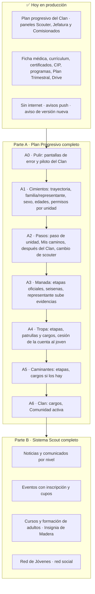

# Hoja de ruta — de Plan Progresivo a sistema Scout completo

> **Para cualquier chat nuevo:** lee este archivo antes de diseñar o construir una función nueva.
> Aquí están la visión, las reglas que ya decidió el dueño del proyecto (✅), lo que falta decidir (❓),
> el orden de trabajo y cómo se publica. No repitas preguntas que ya tienen respuesta aquí.
> Última actualización: 2026-11-14 (tercera ronda de respuestas del dueño). Cuando se decida algo, se actualiza aquí.

---

## 1. La visión

El proyecto tiene **dos partes**, y se trabajan **en ese orden**:

- **Parte A · Plan Progresivo completo.** Las cuatro unidades (Manada, Tropa, Caminantes y Clan), con el paso
  entre unidades, seisenas, patrullas, cargos y lo que pasa después del Clan. Es lo que se está construyendo ahora.
- **Parte B · Sistema Scout completo de la ASV.** Además de lo progresivo: red social y comunicación, noticias,
  eventos con inscripción, cursos, formación de adultos, Red de Jóvenes y la estructura nacional. Es la idea grande,
  posible **proyecto de tesis de ingeniería de sistemas**. No se empieza hasta cerrar la Parte A.

Estructura de la ASV (contexto para la Parte B):

```
Oficina Nacional (decide en conjunto, «mesa redonda»: es una forma de trabajar, NO un rol de la app)
  └─ Región
       └─ Distrito
            └─ Grupo (Jefatura de Grupo)
                 └─ Unidades: Manada · Tropa · Caminantes · Clan (cada una con 1 o más scouters)
                      └─ Jóvenes (y sus representantes, en Manada y Tropa)
Aparte: Red de Jóvenes (RT Jóvenes), voceros de los jóvenes → Parte B
```

**Principio de diseño:** primero los cimientos (la trayectoria de cada persona con fechas, la familia y los estados);
encima, lo demás. Así cada función nueva no obliga a rehacer las anteriores.

---

## 2. Dónde estamos y a dónde vamos



Cada unidad (A3 a A6) se publica **entera** cuando esté lista, no a pedazos (ver §5).

---

## 3. Reglas ya decididas (✅)

### 3.1 Edades (única regla nacional)
| Unidad | Edades | Pasa a la siguiente al cumplir |
|---|---|---|
| Manada | 7 a 10 | **11** → Tropa |
| Tropa | 11 a 15 | **16** → Caminantes |
| Caminantes | 16 a 17 | **18** → Clan |
| Clan | 18 a 20 | **21** → máxima insignia (Rover Ciudadano) o partida de la unidad |
- ✅ La edad **no** pasa a nadie sola: solo avisa a la Jefatura que «ya le toca».
- Hoy la app usa rangos que se pisan (10 y 18 valen para dos unidades): hay que corregirlo en A1.

### 3.2 Paso de unidad
- ✅ La fecha la elige el grupo: es la **ceremonia de pase**, que suele coincidir con la de máxima insignia.
  Se puede anotar en el Plan Trimestral.
- ✅ En la app, **la Jefatura** hace el paso y **un scouter de la unidad de destino lo acepta**.
- ✅ Se pasa **con o sin** la máxima insignia de la unidad. La meta es completarla, pero quien entra tarde
  (por ejemplo, a Tropa a los 13) puede no lograrlo y pasa igual.
- ✅ Se avisa al **joven, al representante y a los scouters** (los de origen y los de destino).
- ✅ **«Mis caminos»:** lo hecho en cada unidad queda como historial **solo para ver** (Caminos de Manada,
  de Tropa, de Caminantes, de Clan), con etapas, insignias y fechas.
- ✅ **Paso equivocado:** se puede cancelar mientras el scouter de destino no lo acepte. Si ya lo aceptó, la Jefatura
  lo devuelve. En el **registro de la Jefatura** quedan ambos movimientos, el equivocado marcado como «anulado», para
  saber quién hizo qué. En **«Mis caminos» del joven solo se ve el correcto**.

### 3.3 Quién llena el plan, representantes y cuentas
- ✅ **Manada y Tropa:** el plan lo llena **el scouter** y las evidencias las sube **el representante**. Así los dos
  trabajan juntos y ambos ven el avance del niño.
- ✅ **Caminantes y Clan:** el joven llena su plan (como hoy en el Clan).
- ✅ **Un representante, una cuenta, varios hijos:** con su cuenta ve a todos sus hijos (dos, tres…) y el avance de cada uno.
- ✅ **Cesión de la cuenta al pasar a Tropa:** al representante le llega un formulario: «Su joven ya está en Tropa»;
  «¿Tiene permiso para usar un teléfono propio?»; «¿Está de acuerdo en que el joven empiece a manejar su plan
  progresivo él solo?». Si dice **sí**, el joven recibe su propio acceso (correo y contraseña) y su historial completo.
  Si dice **no**, el joven no maneja su cuenta y sigue como en Manada.
- ✅ En Tropa, el joven con cuenta propia **ve su avance, sube sus certificados y marca sus requisitos**
  (❓ lo de marcar requisitos está aún por confirmar por el dueño).
- ✅ Después de la cesión, **el representante ya no ve nada** de ese hijo (deja de estar en su cuenta).
- ✅ Los hijos de Manada (sin correo propio) los **agrega el representante desde su cuenta** («Agregar hijo»).

### 3.4 Después del Clan
- ✅ La máxima insignia del Clan es **Rover Ciudadano**. Si cumple 21 sin terminarla, sale sin la máxima; su historial
  muestra hasta dónde llegó. Depende de cuándo empezó y de su dedicación.
- ✅ Después del Clan puede ser **scouter (dirigente)**, quedar como **comunidad activa / adulto colaborador**
  (son lo mismo: no está registrado en el grupo pero apoya en actividades), o **pausar** y volver años después.
- ✅ **Comunidad activa:** sigue en la app para que la Jefatura la lleve en sus Excel y en la renovación anual.
  Qué más puede hacer se decide después.
- ✅ Si vuelve como dirigente, la **Jefatura le asigna una unidad y el rol de scouter**.
- ✅ Debe ver su recorrido completo. La formación de adultos y la Insignia de Madera van en la **Parte B**.

### 3.5 Scouters
- ✅ Una unidad puede tener **varios scouters**, y todos pueden hacer cambios administrativos: seisenas, patrullas,
  aprobar o devolver el plan.
- ✅ **Cada scouter solo ve y cambia a los jóvenes de su unidad**; la Jefatura, a todo el grupo. Hoy la base de datos
  deja a cualquier scouter tocar todo el grupo: se corrige en A1 (reglas de Supabase por unidad).
- ✅ Un scouter puede retirarse de la unidad o del grupo, o tomarse un tiempo. La **Jefatura** hace el «cambio de
  scouter»: el que sale **pierde el acceso** a la unidad, y la Jefatura puede darle otra función (por ejemplo, una
  parte administrativa).

### 3.6 Seisenas (Manada)
- ✅ Las arman y las cambian **los scouters de la Manada**.
- ✅ Los colores son **libres**: el scouter elige el color al crear la seisena. También puede pasar
  todas las seisenas a otro color.
- ✅ El tope es de **6**, pero cada seisena puede permitir más (por ejemplo 7) para no dejar a un niño solo:
  un interruptor más la cantidad que necesiten.
- ✅ Sin cargos, salvo el **seisenero o seisenera**, que **lo elige la scouter**.
- ✅ Cada seisena puede ser **solo niños, solo niñas o mixta**, así que se agrega el **sexo** al registro (también
  sirve para las patrullas).
- ✅ Para qué sirve: ver si cada seisena lleva su plan al día; guardar sus actividades; y que los **representantes
  suban PDF** que quedan ordenados por seisena y luego por joven.
- ✅ Un lobato entra a la app después de un mes de prueba (unos 4 sábados) y de pagar el registro, así que
  **siempre se ubica en una seisena al aprobar su cuenta**.

### 3.7 Patrullas (Tropa)
- ✅ Los nombres son **libres**: los jóvenes eligen el animal que quieren representar.
- ✅ Cargos de una **lista general para todos los grupos**: guía, subguía, secretario, tesorero… El dueño no tiene la
  lista completa: se saca del material oficial (A4).
- ✅ Una patrulla se puede cerrar, crear, fusionar o **refundar** con un nombre viejo. **Todo lo que la app guarde
  de la patrulla migra** a la nueva, y queda el antecedente («antes se llamaba Lobos»). Más adelante se agregarán más
  datos de patrulla.
- Propuesta de qué guarda una patrulla (❓ el dueño pidió sugerencias; elegir en A4): miembros con su cargo y fechas;
  nombre, animal, color, grito y lema; **libro de patrulla** (actas del consejo de patrulla, acuerdos); **puntos** de las
  competencias de la Tropa; campamentos y salidas con quiénes fueron; álbum de fotos (Drive); **inventario del rincón**
  (carpas, ollas, cuerdas) a cargo del intendente; **caja** de la patrulla a cargo del tesorero; avance del plan de sus
  miembros. Todo eso migra al cerrar o renombrar la patrulla.
- ✅ Las reorganizaciones se hacen cuando hacen falta, no en fechas fijas.
- ✅ Un joven normalmente **no** cambia de patrulla a mitad de año, salvo casos especiales (problemas, o un subguía
  que toma el liderazgo de otra patrulla que quedó vacía). La app lo permite, pero deja registro.

### 3.8 Caminantes y Clan
- ✅ El Clan es **individual en su desarrollo y grupal en las actividades**. Tiene cargos de la lista general:
  secretario, tesorero, armador del programa (hace los programas de los fines de semana), intendente…
- ❓ Caminantes: el dueño no sabe si tienen cargos o equipos; se revisa en el material oficial (A5).

### 3.9 Configuración y visibilidad
- ✅ Cada grupo configura **colores y nombres**. Son nacionales las **edades** y las **listas de cargos**.
- ✅ Un joven ve **toda su unidad**, no solo su seisena o patrulla.

### 3.10 Parte B (anotado para después, no se construye ahora)
- ✅ **Red de Jóvenes (RT Jóvenes):** comunicación hacia los jóvenes, como los grupos estudiantiles de la universidad:
  flyers, comunicados, convocatorias («acércate y participa»).
- ✅ **Noticias, eventos y cursos:** los puede publicar cualquier nivel: nacional, región, distrito, Red de Jóvenes o un
  grupo. Ejemplo: Orión 84 organiza un «Concurso de cocina primitiva», invita a toda Venezuela, con inscripción y
  100 cupos.
- ✅ La «mesa redonda» de la Oficina Nacional no es un rol: era un ejemplo de cómo se decide allí.

---

## Cómo arrancar el próximo chat

**Estado al 2026-11-14:** el Clan está en producción y probado (19 pruebas unitarias, pruebas SQL, 70 de pantallas
y 52 flujos en teléfono y computadora). Las unidades Manada, Tropa y Caminantes ya pueden registrarse y usar todo,
pero ven las etapas del Clan con un aviso.

**Siguiente paso: diseñar la fase A1 (Cimientos)**, sin esperar el material oficial:
1. Leer este archivo completo.
2. Revisar el código actual: `profiles` (un solo campo `unit`), reglas de Supabase (`puede_gestionar` deja a
   cualquier scouter tocar todo el grupo), `AdministracionScreen`, `RegisterScreen` y `src/data/unitTemplates.ts`.
3. Escribir el diseño en `docs/` (por ejemplo `docs/A1-cimientos.md`): tablas nuevas (trayectoria con fechas, familia
   representante–hijos), cambios de registro (sexo, «Agregar hijo»), edades sin solapes, reglas por unidad y la base
   de datos de pruebas (§5). El dueño lo aprueba antes de programar.
4. Trabajar en una rama (§5), no directo en `main`.

**Otros pendientes del dueño** (no bloquean A1): primer respaldo semanal automático (domingo 15-nov), probar el
Plan Trimestral de Lisbeth con una cuenta real, decidir el requisito de cursos marcado sin certificado de una joven
del Clan, y conseguir el material oficial de Manada, Tropa y Caminantes.

---

## 4. Fases de la Parte A

| Fase | Qué incluye | Depende de |
|---|---|---|
| **A0 · Pulir** | ✅ Pantallas «Esta página no existe», «No se puede conectar con el servidor» y «No se pudo cargar la app», con código de error (publicadas el 2026-11-14, commit 907315d). El dueño confirmó en su teléfono el arreglo de Gestionar CIP; el piloto con el Clan ya está activo. | — |
| **A1 · Cimientos** | Trayectoria de cada persona con fechas (unidad, rol y estado: desde, hasta, motivo). Estados (activo, en pausa, retirado, comunidad activa). **Cuenta de representante con varios hijos.** Sexo en el registro. Tabla de edades sin solapes. **Permisos por unidad** (§7, pregunta 4). | Respuestas de §7 |
| **A2 · Pasos** | Paso de unidad (la Jefatura propone y el scouter de destino acepta, con avisos y anulación). «Mis caminos». Después del Clan. Cambio de scouter. | A1 |
| **A3 · Manada** | Etapas oficiales en `src/data/unitTemplates.ts`. El scouter llena el plan y el representante sube evidencias. Seisenas. PDF por seisena. | Material oficial, A1 |
| **A4 · Tropa** | Etapas oficiales. Patrullas y cargos con migraciones. Formulario de cesión de la cuenta al joven. | A2, A3 |
| **A5 · Caminantes** | Etapas oficiales. Cargos o equipos si los hay. | Material |
| **A6 · Clan** | Cargos del Clan. Comunidad activa en los Excel y la renovación anual. | A1 |

**Nota técnica para A3:** 9 archivos usan hoy las etapas del Clan directo (`stagesData`): dataService, cipLogic,
insigniasReport, StageDetail, ScouterReview, ScouterDashboard, CatalogSelector, ScoutFullProfile y graphifyBridge.
Hay que pasarlos a `getStagesForUnit()`.

Cuando empiece cada fase se escribe su diseño detallado en `docs/` y se aprueba antes de programar.

---

## 5. Cómo se publica (✅ aprobada la idea; se arma al empezar A1)

**Hoy:** cada cambio subido a `main` se publica solo en Vercel en 2–3 minutos y lo ven todos.

**Propuesta:**
- **`main` = la app real.** Solo entra lo terminado: una unidad completa, o un arreglo urgente del Clan.
- **Una rama por fase** (por ejemplo `manada`). Lo subido ahí **no cambia la app real**: Vercel arma una
  **vista previa** con su propio enlace, solo para probar. Cuando la fase está lista y probada, se une a `main`
  y entonces se publica para todos, con una nota de novedades.
- **Base de datos de pruebas:** la vista previa, si no se cambia nada, usa **la misma base de datos real**. Lo que se
  pruebe ahí escribiría datos reales, y una tabla nueva (por ejemplo, seisenas) aparecería en la base real.
  Por eso se propone **un segundo proyecto de Supabase solo para pruebas**, conectado a las vistas previas. El plan
  gratis lo permite (❓ verificar al crearlo). Así la app real no se toca hasta publicar.
- Los cambios en la base real se hacen **al publicar la fase**, con su SQL probado (`npm run test:sql`).

---

## 6. Lo que ya existe y sirve de base
- Roles: `scout`, `scouter`, `jefe_grupo`, `comisionado_distrital`, `comisionado_regional`, `nacional`, `admin`.
- Territorio: regiones, distritos y grupos en [`src/data/territory.ts`](../src/data/territory.ts) y la tabla `scout_groups`.
- Unidades y edades: [`src/data/unitTemplates.ts`](../src/data/unitTemplates.ts). Hoy solo tiene la plantilla del Clan;
  las otras unidades la usan con un aviso.
- Tabla `unit_subgroups` (vacía, sin uso): un intento de seisenas sin miembros. Su regla de escritura está abierta a
  cualquiera con sesión, así que hay que rehacerla en A3.
- Historial de cambios (`audit_log`) y aprobación de cuentas: sirven para los registros de pasos y cambios.
- `profiles.unit` es un solo campo de texto: Caminantes se guarda como `comunidad`.
- Hoy cada cuenta es de una sola persona: no existe la cuenta de representante con varios hijos.

---

## 7. Preguntas abiertas (❓)
1. **Joven de Tropa con cuenta propia:** confirmar si marca él mismo sus requisitos (respuesta provisional: sí).
2. **Listas de cargos** de Tropa y Clan, y si Caminantes tiene cargos o equipos: sacarlas del material oficial.
3. **Qué guarda una patrulla:** elegir de la propuesta de §3.7.
4. **Material oficial** de Manada, Tropa y Caminantes: el dueño lo consigue en los archivos de la ASV (necesario para A3).

---

## 8. Sistema de diseño (rama `rediseno-sistema`, en curso desde el 2026-11-16)

Trabajo aparte de las fases A1–A6, pedido por el dueño: unificar el aspecto de toda la app.

**Decidido por el dueño (✅):**
- ✅ Un solo color de acento por pantalla, que sale de la **rama**: jóvenes y scouters ven el color de su unidad;
  Jefatura y comisionados, el morado. El botón **«Personalizar»** se conserva y reemplaza ese color.
- ✅ Sin emojis en los textos: íconos de línea. Un botón principal por pantalla (acento), los demás con borde gris,
  rojo solo para borrar o devolver.
- ✅ Menú fijo a la izquierda en computadora y **barra inferior** en teléfono para el joven.
- ✅ Se publica en `main` solo cuando **todo** el apartado gráfico esté actualizado.

**Hecho en la rama:** cimientos (`src/theme/tokens.ts`, `src/theme/liveStyles.ts`, `src/components/ui/`), navegación
del joven, Resumen (con «Qué te falta»), Plan Progresivo, Detalle de etapa (hoja de envío, confirmación, etapa
devuelta), revisión y panel del Scouter, cabecera de paneles, y un pase automático de colores, emojis, radios de
borde (8 / 12 / 16) y letra mínima de 12 en todas las pantallas. Además:
- **Formularios por pasos** en teléfono: Ficha Médica (4 pasos) y Currículum (7 pasos). En computadora, y para quien
  solo consulta, siguen completos. «Guardar» sirve desde cualquier paso.
- **Versión de Manada**: los lobatos ven la letra un 12 % más grande. Cualquiera puede encenderla o apagarla con
  «Letra grande» en «Personalizar» (se guarda en el teléfono, clave `app_large_text`).
- **Animaciones**: la pantalla que entra aparece y sube (`ScreenTransition`), el aviso de conexión baja desde arriba.
  Todas se apagan si el teléfono pide menos movimiento.

**Falta para publicar:** revisar a mano, pantalla por pantalla, las que solo recibieron el pase automático, y probar
en un teléfono real.

**Pendiente de confirmar (❓):** Manada quedó en **ámbar oscuro** (`#a85d00`) en vez del amarillo oficial, porque la
letra blanca no se lee sobre amarillo en las pantallas que aún no usan las piezas nuevas.

Kit de referencia: https://claude.ai/artifact/9YgmWqThtvRMuPdNQRGDgK
